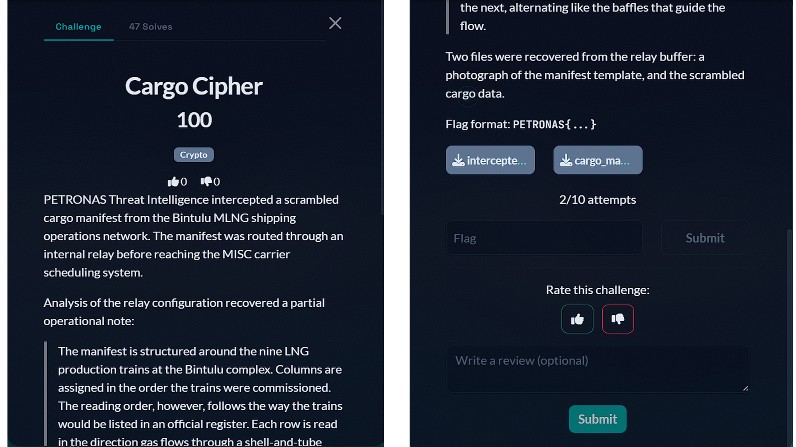

# 1 - Cargo Cipher

## Challenge

<p align="center">
  
</p>

## Solution

# PETCTF 2026 Prelim — Bintulu / "Cargo Cipher" — Beginner Writeup

> **Challenge folder:** `Bintulu/1 - Cargo Cipher`
> **Category:** Crypto
> **Files given:** `intercepted_cargo.txt`, `cargo_manifest.png`
> **Flag format:** `PETRONAS{...}`
> **Final Flag:** `PETRONAS{lng_c4rg0_sh1pm3nt_d3c0d3d}`

This writeup assumes you are new to CTFs. We will walk through exactly how to spot what kind of puzzle this is, how to use the clues provided in the image, and how to write a simple Python script to solve it automatically. 

---

## 1. Step 1 — Initial Reconnaissance

Whenever you start a challenge, look at the files you are given. 

```bash
ls
# asset  cargo_manifest.png  intercepted_cargo.txt  README.md

file cargo_manifest.png intercepted_cargo.txt
# cargo_manifest.png:    PNG image data, 800 x 600, 8-bit/color RGB
# intercepted_cargo.txt: ASCII text, with no line terminators

cat intercepted_cargo.txt
# R41dOcp0N_mcP0_}EgsdTrh3Ag33Snnd{lt_
```

**What we know so far:**
1. We have a scrambled text file that is **36 characters long**. It clearly contains the pieces of a `PETRONAS{...}` flag, but they are jumbled up.
2. We have an image containing a "Manifest" with clues. 
3. The challenge description mentions a "scrambled cargo manifest," "9 LNG production trains," and "alternating like the baffles."

Because the characters themselves haven't been changed (we still see `P`, `E`, `T`, `R`, `O`, `N`, `A`, `S`, `{` in the text), this is a **Transposition Cipher**. That means the letters are just in the wrong *positions*, like a jigsaw puzzle.

---

## 2. Step 2 — Analyzing the Clues

### The Image (`cargo_manifest.png`)
Looking at the image, we see a table with 9 rows (0 to 8). These represent the 9 trains (columns).
*   **Column 0-2:** MLNG Satu (Trains 1-3)
*   **Column 3-5:** MLNG Dua (Trains 4-6)
*   **Column 6-7:** MLNG Tiga (Trains 7-8)
*   **Column 8:** PETRONAS LNG (Train 9)

### The Challenge Text (The Rules)
The description gives us the exact steps to reverse the scrambling:
1.  *"The manifest is structured around the nine LNG production trains..."* → **We have 9 columns.**
2.  *"Columns are assigned in the order the trains were commissioned."* → **When we chop up our 36-character string, we read left-to-right as Column 0, 1, 2... up to 8.**
3.  *"The reading order, however, follows the way the trains would be listed in an official register."* → **We must reorder the columns by grouping them by complex.** 
4.  *"Each row is read in the direction gas flows through a shell-and-tube... alternating like the baffles."* → **We read the final grid in a "snake" pattern (Left-to-Right, then Right-to-Left).**

---

## 3. Step 3 — Reconstructing the Grid

### A. Split the text
We have 36 characters and 9 columns. 
`36 / 9 = 4`. So, each column gets exactly **4 characters** (4 rows).

Let's slice the text string into 9 chunks of 4 characters:
*   Train 1 (Col 0): `R41d`
*   Train 2 (Col 1): `Ocp0`
*   Train 3 (Col 2): `N_mc`
*   Train 4 (Col 3): `P0_}`
*   Train 5 (Col 4): `Egsd`
*   Train 6 (Col 5): `Trh3`
*   Train 7 (Col 6): `Ag33`
*   Train 8 (Col 7): `Snnd`
*   Train 9 (Col 8): `{lt_`

### B. Reorder the columns ("Official Register")
The clue says to read the manifest the way an official register would list them. If we look at the "Complex" column in the image, grouping them alphabetically means:
1.  **MLNG Dua** (Cols 3, 4, 5)
2.  **MLNG Satu** (Cols 0, 1, 2)
3.  **MLNG Tiga** (Cols 6, 7)
4.  **PETRONAS LNG** (Col 8)

*(Note: In programming, lists start at 0. So MLNG Dua is indices 3,4,5. MLNG Satu is 0,1,2, etc.)*

Let's rearrange our chunks into this new order (3, 4, 5, 0, 1, 2, 6, 7, 8):

| Row | Col 3 (Dua) | Col 4 (Dua) | Col 5 (Dua) | Col 0 (Satu) | Col 1 (Satu) | Col 2 (Satu) | Col 6 (Tiga) | Col 7 (Tiga) | Col 8 (PETRONAS) |
| :--- | :--- | :--- | :--- | :--- | :--- | :--- | :--- | :--- | :--- |
| **0** | P | E | T | R | O | N | A | S | { |
| **1** | 0 | g | r | 4 | c | _ | g | n | l |
| **2** | _ | s | h | 1 | p | m | 3 | n | t |
| **3** | } | d | 3 | d | 0 | c | 3 | d | _ |

### C. Read the "Baffle" pattern
The final clue tells us to read like a shell-and-tube heat exchanger, alternating direction row by row:
*   Row 0: **Left to Right** → `PETRONAS{`
*   Row 1: **Right to Left** → `lng_c4rg0`
*   Row 2: **Left to Right** → `_sh1pm3nt`
*   Row 3: **Right to Left** → `_d3c0d3d}`

If we put it all together, we get our flag!

---

## 4. Step 4 — Automating with Python

Manually solving this is great for learning, but in a real CTF, automating it is faster. Here is a clean Python script that does exactly what we did above.

Create a file called `solve.py`:

```python
# The intercepted text
ciphertext = "R41dOcp0N_mcP0_}EgsdTrh3Ag33Snnd{lt_"

# 1. Split the text into 9 chunks of 4 characters
# ciphertext[0:4] gives chars 0 to 3, [4:8] gives 4 to 7, etc.
chunks = []
for i in range(0, 36, 4):
    chunks.append(ciphertext[i:i+4])

# 2. Define the "Official Register" order based on the image
# Dua(3,4,5) -> Satu(0,1,2) -> Tiga(6,7) -> PETRONAS(8)
official_order = [3, 4, 5, 0, 1, 2, 6, 7, 8]

# Rearrange the chunks according to the official order
sorted_chunks = []
for index in official_order:
    sorted_chunks.append(chunks[index])

# 3. Build the 4x9 grid
# We loop 4 times (rows), and grab the character at that index from each chunk
grid = []
for row in range(4):
    current_row = []
    for col in range(9):
        current_row.append(sorted_chunks[col][row])
    grid.append(current_row)

# 4. Read using the "baffle" snake pattern
flag = ""
for row_index, row in enumerate(grid):
    if row_index % 2 == 0:
        # Even rows (0, 2): Read Left to Right
        flag += "".join(row)
    else:
        # Odd rows (1, 3): Read Right to Left
        flag += "".join(reversed(row))

print("Flag:", flag)
```

Run it in your terminal:
```bash
python3 solve.py
```

**Output:**
```
Flag: PETRONAS{lng_c4rg0_sh1pm3nt_d3c0d3d}
```

---

## 5. Summary of Techniques Learned

*   **Transposition Ciphers:** Ciphers where the letters don't change, but their order does.
*   **Columnar Transposition:** Splitting text into columns based on a clue (in this case, the 9 trains in the manifest).
*   **Boustrophedon Reading:** The fancy word for the "snake" pattern (alternating Left-to-Right / Right-to-Left), which the challenge disguised as "baffles in a heat exchanger."
*   **Reading the Clues:** In CTF crypto challenges, the description text often acts as the exact algorithm you need to write.

## Flag

```text
PETRONAS{lng_c4rg0_sh1pm3nt_d3c0d3d}
```
