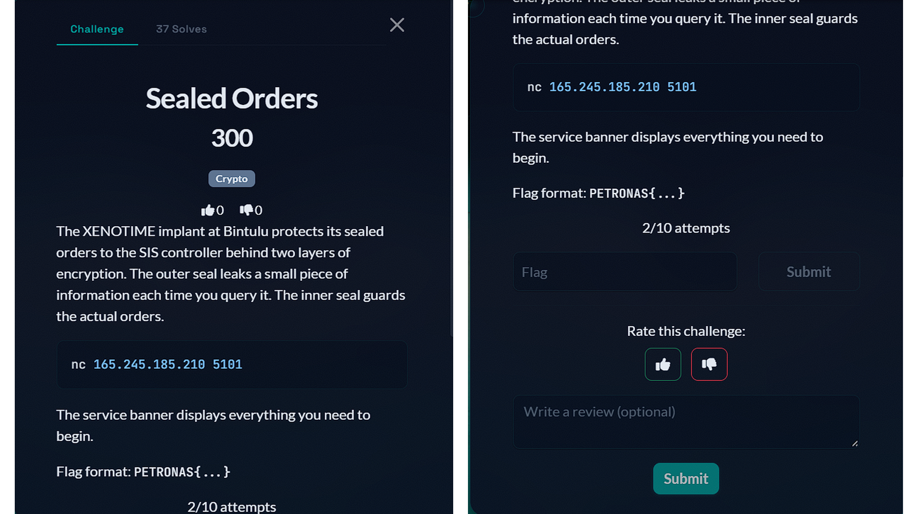

# 5 - Sealed Orders

## Challenge

<p align="center">
  
</p>

## Solution

### 1. Connect to the challenge

The challenge provides a TCP service. We can connect to it using Netcat:

```bash
nc 165.245.185.210 5101
```

After connecting, the server displays a banner containing the encryption details and available commands.

The important information is:

- The challenge uses two layers of RSA encryption.
- The first layer protects a secret value called `PREFIX`.
- The second layer uses `PREFIX` together with the flag.
- The server provides an `lsb` command that reveals the least significant bit of an RSA decryption.
- We are allowed 3000 oracle queries per session.

The available command is:

```text
lsb <hex>
```

This command accepts a hexadecimal number and tells us whether its decrypted value is even or odd.

This is important because it gives us a way to attack the first RSA layer without knowing its private key.

### 2. Understand the RSA LSB oracle

RSA encryption follows this formula:

```text
c = m^e mod n
```

Where:

- `m` is the original message.
- `c` is the encrypted message.
- `e` is the public exponent.
- `n` is the RSA modulus.

Normally, recovering the original message from the ciphertext is difficult without the private key.

However, this challenge gives us an oracle that reveals one bit of information about a decrypted value:

```text
0 = even
1 = odd
```

This is known as an **LSB oracle attack**.

The useful property of RSA is that it is multiplicative. By multiplying the original ciphertext by carefully chosen values, we can make the decrypted result reveal information about the original plaintext.

For this challenge, we repeatedly multiply the ciphertext by powers of 2 and query the oracle.

The challenge provides:

```text
e1 = 65537
L  = 1024
```

We use 1024 oracle queries to recover enough information to reconstruct `PREFIX`.

### 3. Recover the PREFIX

Instead of manually sending hundreds of commands through Netcat, we can automate the attack using Python.

The script performs these operations:

1. Connects to the challenge server.
2. Reads the server banner.
3. Sends the modified ciphertext to the `lsb` command.
4. Collects the returned bits.
5. Reconstructs the original `PREFIX`.
6. Verifies the result by encrypting it again.

The verification is important. If this condition is true:

```python
pow(PREFIX, e1, n1) == c1
```

then the recovered value correctly matches the original ciphertext.

The recovered `PREFIX` is:

```text
0xe03f1d269a31105da5ae5a154c00828a16a93329db8d60fb2bc5e6a58ba22fd4
```

We have now broken the first layer of encryption.

### 4. Understand the second RSA layer

The server also provides another RSA encryption formula:

```text
c2 = (PREFIX * 2^1024 + FLAG)^3 mod n2
```

The important values are:

```text
e2 = 3
L  = 1024
```

We already know `PREFIX`, so we can calculate the known part of the plaintext:

```python
const = PREFIX * (1 << 1024)
```

This means the encrypted message is:

```text
const + FLAG
```

The remaining task is to recover the flag.

A direct cube root of `c2` will not work because the original plaintext was raised to the power of 3 and reduced modulo `n2`.

The intended approach involves Coppersmith's method, which can recover small unknown values from certain modular equations.

However, we can use a simpler mathematical shortcut for this challenge.

### 5. Recover the flag using an algebraic shortcut

We know:

```text
c2 = (const + FLAG)^3 mod n2
```

The expression can be expanded using the binomial theorem:

```text
(const + FLAG)^3
= const^3
+ 3 * const^2 * FLAG
+ 3 * const * FLAG^2
+ FLAG^3
```

Because the result is reduced modulo `n2`, there is an unknown integer `k` such that:

```text
(const + FLAG)^3 = c2 + k * n2
```

We can estimate `k` using:

```python
k_approx = (const**3 - c2) // n2
```

For this challenge, the correction caused by the flag-related terms is extremely small compared with `n2`.

As a result, the correct value of `k` is found by trying nearby integers, starting with:

```python
k = k_approx
```

We then calculate:

```python
candidate = c2 + k * n2
```

If `candidate` is a perfect cube, its integer cube root gives us:

```text
const + FLAG
```

We simply subtract `const` to recover the flag as an integer.

The script uses an integer cube-root function to check each candidate. It does not use floating-point arithmetic, which is important when working with numbers this large.

For the actual challenge, the correct candidate is found at:

```text
delta = 1
```

This means we successfully recover the flag without needing to run Coppersmith's method.

### 6. Convert the recovered number into the flag

After recovering the flag as an integer, we convert it into bytes:

```python
byte_count = (FLAG.bit_length() + 7) // 8
flag_bytes = FLAG.to_bytes(byte_count, 'big')
```

We then search the resulting bytes for the expected flag format:

```python
import re

match = re.search(rb'PETRONAS\{[^}]+\}', flag_bytes)

if match:
    print(match.group(0).decode())
```

The recovered flag is:

```text
PETRONAS{b1ntulu_s34l3d_0rd3rs_c0pp3rsm1th}
```

### 7. What we learned

This challenge involved two separate RSA weaknesses.

**First layer: LSB oracle attack**

The server revealed whether the decrypted ciphertext was even or odd. By repeatedly modifying the ciphertext and collecting the returned bits, we recovered the original `PREFIX`.

**Second layer: Small unknown value**

The second RSA layer used a public exponent of 3 and included a known part of the plaintext. Instead of implementing the more complicated Coppersmith attack, we used the relationship between the known plaintext, the modulus, and the small flag value to recover the original integer.

The main lessons are:

- Read the challenge banner carefully. It contains important information about the encryption and available oracle.
- Recognize when a service exposes an oracle that leaks information about decrypted data.
- Automate repeated oracle queries with Python.
- Verify recovered RSA plaintext by encrypting it again.
- Check the sizes of the numbers before choosing an attack.
- Try simpler mathematical approaches before implementing more complicated techniques such as Coppersmith's method.

## Flag

```text
PETRONAS{b1ntulu_s34l3d_0rd3rs_c0pp3rsm1th}
```