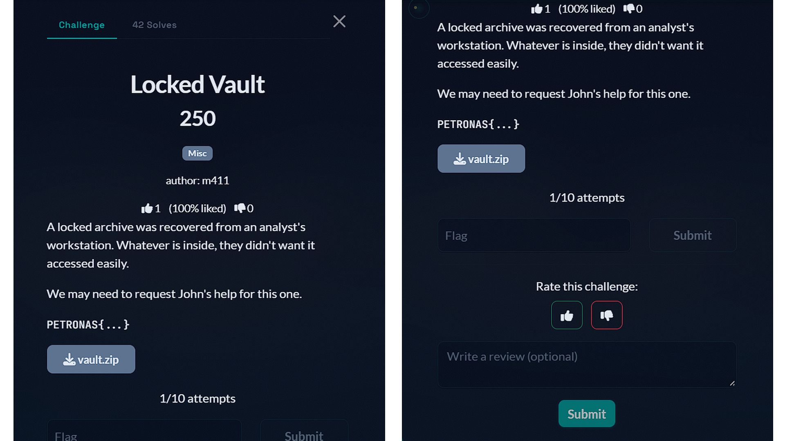

# 2 - Locked Vault

## Challenge

<p align="center">
  
</p>

## Solution

# PETCTF 2026 Prelim — KLCC / "Locked Vault" — Beginner Writeup

> **Challenge folder:** `KLCC/2 - Locked Vault`
> **Files given:** `vault.zip` (260 bytes), `README.md`, `asset/`
> **Goal:** Extract `flag.txt` from an AES-256 encrypted ZIP and read the flag.
> **Found password:** `tsniikhm_sector7_2017`
> **Flag:** `PETRONAS{CR4CK3D_TH3_V4ULT}`

This writeup assumes you have never solved a CTF before. Every command is explained,
and we'll go slowly through *why* each step works, not just *what* to type.

---

## Table of Contents

1. [Challenge overview](#1-challenge-overview)
2. [Step 0 — Basic recon with `file` and `ls`](#2-step-0--basic-recon-with-file-and-ls)
3. [Step 1 — Peek inside the ZIP without extracting](#3-step-1--peek-inside-the-zip-without-extracting)
4. [Step 2 — Read the ZIP comment (the big hint)](#4-step-2--read-the-zip-comment-the-big-hint)
5. [Step 3 — Understand *what kind* of encryption we're dealing with](#5-step-3--understand-what-kind-of-encryption-were-dealing-with)
6. [Step 4 — Why `unzip` fails but `7z` works](#6-step-4--why-unzip-fails-but-7z-works)
7. [Step 5 — Fetch the wordlist from the URL](#7-step-5--fetch-the-wordlist-from-the-url)
8. [Step 6 — Deal with Windows line endings (CRLF)](#8-step-6--deal-with-windows-line-endings-crlf)
9. [Step 7 — Brute-force the password with a bash loop](#9-step-7--brute-force-the-password-with-a-bash-loop)
10. [Step 8 — Extract the flag](#10-step-8--extract-the-flag)
11. [Step 9 — Reading the flag](#11-step-9--reading-the-flag)
12. [Why this is a *good* beginner challenge](#12-why-this-is-a-good-beginner-challenge)
13. [Common pitfalls & how to avoid them](#13-common-pitfalls--how-to-avoid-them)
14. [Final flag](#14-final-flag)
15. [Cheat sheet — commands used](#15-cheat-sheet--commands-used)

---

## 1. Challenge overview

We're given a tiny ZIP file called `vault.zip`. It contains exactly one file: `flag.txt`.
But the ZIP is **encrypted with AES-256**, so we can't just open it.

The hints we get:

- The file is called **"Locked Vault"** → we need a **key/password** to "unlock" it.
- The folder is called **KLCC** → Kuala Lumpur City Centre, home of the **Petronas Twin Towers**.
  This is theming: the challenge is set in a fictional Malaysian oil & gas company (Petronas).
- The ZIP contains a **comment** that points to a Pastebin URL.
  That URL turns out to be a **wordlist of passwords** — not a single password.

Our job is essentially:

> Try every password in the wordlist until one works.

That is called a **dictionary attack** (or "wordlist brute-force"). It's a very common CTF technique.

---

## 2. Step 0 — Basic recon with `file` and `ls`

Before you run a single exploit, always start with the absolute basics:

```bash
ls -la
file vault.zip
```

`ls -la` shows all files, including hidden ones, and their sizes.
`file` tells us what a file *actually* is, which is more reliable than trusting the extension.

Output we got:

```
vault.zip: Zip archive data, at least v5.1 to extract, compression method=AES Encrypted
```

Two useful facts to notice:

- **"at least v5.1 to extract"** — this is a *version floor*. Modern ZIPs use something called
  **WinZip AES**, which requires more recent tools. If you try to extract with an old tool,
  it may complain or silently fail.
- **"compression method=AES Encrypted"** — the ZIP uses AES. Classic ZIP encryption is weak
  (ZIP 2.0 crypto), but AES-256 is genuinely strong. So we're not going to *crack* the crypto —
  we're going to **guess the password**.

> **Beginner takeaway:** In CTFs, "encrypted file" almost never means "break the math."
> It usually means "find the password (somewhere in the challenge) or guess it from a wordlist."

---

## 3. Step 1 — Peek inside the ZIP without extracting

You don't need to extract a ZIP to see its file list:

```bash
unzip -l vault.zip
```

Output:

```
  Length      Date    Time    Name
---------  ---------- -----   ----
       27  2026-11-11 06:13   flag.txt
---------                     -------
       27                     1 file
```

So `flag.txt` is only **27 bytes** compressed → **27 bytes** uncompressed.
That's a really short file, consistent with a flag like `PETRONAS{...}`.

To get *all* the metadata, use `zipinfo` with the verbose flag:

```bash
zipinfo -v vault.zip
```

This is a firehose of information, but a few lines matter:

```
  minimum software version required to extract:   5.1
  compression method:                             unknown (99)
  file security status:                           encrypted
  ...
  CRC value (hex):                                00000000
  compressed size:                                55 bytes
  uncompressed size:                              27 bytes
  ...
  The central-directory extra field contains:
  - A subfield with ID 0x9901 (unknown) and 7 data bytes:
    02 00 41 45 03 00 00
```

Translation for a beginner:

| Field | Meaning |
|---|---|
| `compression method: unknown (99)` | This is **method 99**, the WinZip AES marker. Info-ZIP's `unzip` historically doesn't support it. |
| `file security status: encrypted` | Confirms the file is encrypted. |
| `CRC = 00000000` | AES mode deliberately zeroes the CRC, so we can't use CRC to verify guesses. We have to rely on "does extraction succeed?" |
| `subfield 0x9901` with `02 00 41 45 03 00 00` | `02` = AES-256 strength, `41 45` = "AE" (AES marker), `03` = AE-2 format. |

So this is **WinZip AES-256, AE-2 format**. Good to know.

---

## 4. Step 2 — Read the ZIP comment (the big hint)

ZIP files can carry a "comment" field in their central directory, separate from file contents.
Two ways to read it:

```bash
unzip -z vault.zip
```

or:

```bash
7z l -slt vault.zip | grep -i comment
```

Both showed:

```
https://pastebin.com/raw/UQH2EwHX
```

**This is the hint.** The challenge author is telling us: "the passwords you need are at this URL."

> **Beginner takeaway:** When a ZIP looks impossible, check its **comment**. Tools:
> - `unzip -z vault.zip` → comment
> - `zipinfo -v vault.zip` → full metadata, including comment
> - `xxd vault.zip | tail` → raw bytes near the end (the comment is literally just trailing bytes in the file)

---

## 5. Step 3 — Understand *what kind* of encryption we're dealing with

This matters because **different tools handle AES ZIPs differently**.

There are three ZIP encryption schemes you'll encounter in CTFs:

| Name | Marker | Crackable? | Handled by `unzip`? |
|---|---|---|---|
| Legacy ZipCrypto | small flag bit | **Yes**, trivially (known-plaintext attack) | Yes |
| PKWARE AES | extra field `0x9901` | Only by guessing | Old versions: **no** |
| WinZip AES | extra field `0x9901` with `AE` bytes | Only by guessing | Depends |

We saw `41 45` (`AE`) in the extra field → **WinZip AES**, method 99.
Classic `unzip` on Kali often refuses with:

```
unsupported compression method 99
```

The solution is to use **7-Zip**, which supports method 99 natively.

Verify 7z is installed:

```bash
7z
```

If not:

```bash
sudo apt update && sudo apt install -y p7zip-full
```

> **Beginner takeaway:** If `unzip` fails on an encrypted ZIP, try `7z`.
> If `7z` fails too, try `john` + `zip2john` (but that's for legacy ZipCrypto, not AES-256).

---

## 6. Step 4 — Why `unzip` fails but `7z` works

`unzip` is the classic Info-ZIP tool. It's great for standard ZIPs but its **WinZip AES** support
is patchy. `7z` handles WinZip AES out of the box:

```bash
7z l -slt vault.zip
```

Notice the line:

```
Method = AES-256 Store
Encrypted = +
```

- **AES-256** → the encryption algorithm.
- **Store** → no compression at all (files are stored as-is, just encrypted).
- **Encrypted = +** → yes, we need a password.

Try opening it with no password:

```bash
7z x vault.zip
```

You'll get something like:

```
Enter password (will not be echoed):
ERROR: Wrong password : flag.txt
```

You can also test a password non-destructively:

```bash
7z t -p"anything" vault.zip
```

`t` = test, doesn't extract. Return code is 0 if the password worked, non-zero otherwise.
**That return code is going to be our detector in the brute-force loop.**

> **Beginner takeaway:** `7z t` returns 0 only when the password is correct.
> This is the trick that makes brute-forcing possible from bash.

---

## 7. Step 5 — Fetch the wordlist from the URL

```bash
curl -fsSL https://pastebin.com/raw/UQH2EwHX -o paste.txt
```

Breakdown of the `curl` flags:

| Flag | Meaning |
|---|---|
| `-f` | Fail silently on HTTP errors (don't save error pages to file) |
| `-s` | Silent mode (no progress bar) |
| `-S` | Show errors even in silent mode |
| `-L` | Follow redirects |
| `-o paste.txt` | Save to a file instead of printing to stdout |

Now inspect it:

```bash
wc -l paste.txt           # how many lines?
head -5 paste.txt         # first 5 lines
xxd paste.txt | head -3   # raw bytes
```

We got **999 lines** of Malaysian oil & gas themed passwords:

```
petronas_unit1
carigali_new
gebeng_v3
bintulu_sis
klcc_ops
carigali_prod
petronas_v1
melaka_omega
klcc_eng
pcsb_omega
...
```

You may also notice several entries ending in `l0ck3d` — for example `klcc_l0ck3d`,
`gebeng_l0ck3d`, `melaka_l0ck3d`, `johor_l0ck3d`, `pengerang_l0ck3d`.
Those are the author winking at us — but the *actual* answer turns out to be different.

Looking at the raw bytes:

```
00000000: 7065 7472 6f6e 6173 5f75 6e69 7431 0d0a  petronas_unit1..
```

Notice the `0d0a` at the end. **`0d` = carriage return, `0a` = line feed.**
That's **CRLF** — the Windows line-ending format. Pastebin returned the list as Windows text.

This matters a lot, as we'll see.

---

## 8. Step 6 — Deal with Windows line endings (CRLF)

If you feed the file straight into a loop that reads "each line = one password,"
every password will come out with a hidden `\r` at the end:

```
"petronas_unit1\r"
"gebeng_v3\r"
"tsniikhm_sector7_2017\r"   ← not equal to "tsniikhm_sector7_2017"
```

The ZIP password is `tsniikhm_sector7_2017` with **no** `\r`. So every comparison fails.
This is one of the most common beginner gotchas in CTFs.

Fix it once:

```bash
tr -d '\r' < paste.txt > passlist.txt
```

- `tr` = translate/delete characters
- `-d '\r'` = delete carriage returns
- `< paste.txt` = read from paste.txt
- `> passlist.txt` = write to passlist.txt

Sanity check:

```bash
wc -l passlist.txt
xxd passlist.txt | head -2
```

You should now see `0a` only, not `0d0a`. We got:

```
999 passlist.txt
```

> **Beginner takeaway:** In any challenge that involves a file from the internet, assume CRLF
> until proven otherwise. `file passlist.txt` sometimes tells you ("with CRLF line terminators").
> And `xxd` never lies.

---

## 9. Step 7 — Brute-force the password with a bash loop

Now the actual attack. Here's the loop:

```bash
while IFS= read -r pass; do
    if 7z t -p"$pass" vault.zip >/dev/null 2>&1; then
        echo "[+] PASSWORD FOUND: $pass"
        break
    fi
done < passlist.txt
```

Let's dismantle it line by line:

| Piece | Explanation |
|---|---|
| `while ... ; do ... done` | A bash loop. Runs as long as `read` succeeds. |
| `IFS= read -r pass` | `read` reads one line into the variable `$pass`. `IFS=` prevents bash from trimming leading/trailing whitespace (important because passwords are exact strings). `-r` prevents backslash escaping. |
| `< passlist.txt` | At the very bottom — this redirects the file into the loop as stdin. Each iteration gets the next line. |
| `7z t -p"$pass" vault.zip` | Test the archive with password `$pass`. `-p` = password flag (no space between `-p` and the value). |
| `>/dev/null 2>&1` | Throw away 7z's normal output (`>`) **and** its error output (`2>&1`). We don't want hundreds of lines scrolling by. |
| `if ...; then ... fi` | Runs the block only if the previous command returned exit code 0 (success). `7z t` returns 0 only when the password is correct. |
| `echo "[+] PASSWORD FOUND: $pass"` | Celebrate. |
| `break` | Stop the loop — we found it. |

The `>/dev/null 2>&1` bit deserves a moment. In shell:

- `0` = stdin, `1` = stdout, `2` = stderr.
- `> /dev/null` sends stdout to the "trash can."
- `2>&1` says "make stderr go wherever stdout is going" (also the trash can).

Net effect: **silence**. We only see our own `echo`.

Run it, and a moment later:

```
[+] PASSWORD FOUND: tsniikhm_sector7_2017
```

Not `klcc_l0ck3d` after all — the author put a red herring in. The real password
`tsniikhm_sector7_2017` looks like "tsnii khm sector7 2017", another made-up corporate
style string. It sits somewhere near the middle of the 999-line list, so the loop has
to churn through a couple hundred entries before it hits.

> **Beginner takeaway:** Most "crack this encrypted thing" CTF challenges are just this
> loop with a different tool and a different wordlist. The skill is:
> **identify the format → pick the right tool → pick the right detector → loop.**

---

## 10. Step 8 — Extract the flag

Now that we have the password, extract like normal:

```bash
7z x -p"tsniikhm_sector7_2017" vault.zip -y
```

- `x` = extract, preserving directory structure (vs. `e` which flattens — doesn't matter
  here, but `x` is the habit).
- `-p"tsniikhm_sector7_2017"` = password. **Always quote passwords**, or a `!` in the
  password could trigger history expansion.
- `-y` = "yes to all prompts." Useful in scripts and CTFs.

Output:

```
7-Zip 26.03 (x64) : Copyright (c) 1999-2026 Igor Pavlov : 2026-09-03

Scanning the drive for archives:
1 file, 260 bytes (1 KiB)

Extracting archive: vault.zip
--
Path = vault.zip
Type = zip
Physical Size = 260
Comment = https://pastebin.com/raw/UQH2EwHX

Everything is Ok

Size:       27
Compressed: 260
```

Or, if you want the loop and the extraction in one shot (a good template to reuse):

```bash
while IFS= read -r pass; do
    if 7z x -p"$pass" vault.zip -y >/dev/null 2>&1 && [ -f flag.txt ]; then
        echo "[+] PASSWORD FOUND: $pass"
        echo "[+] FLAG:"
        cat flag.txt
        break
    fi
done < passlist.txt
```

The extra `&& [ -f flag.txt ]` check ensures `flag.txt` actually landed on disk before
we celebrate — belt-and-suspenders.

---

## 11. Step 9 — Reading the flag

```bash
cat flag.txt
```

Result:

```
PETRONAS{CR4CK3D_TH3_V4ULT}
```

If you want to be extra careful about hidden characters (trailing nulls, weird whitespace):

```bash
xxd flag.txt
```

Good habit when the flag format matters — paste the exact bytes.

The flag itself is a nice summary of what we did:
**CR4CK3D_TH3_V4ULT** = "cracked the vault."

---

## 12. Why this is a *good* beginner challenge

This challenge teaches, in one small ZIP:

1. **Reconnaissance** — `file`, `ls`, `zipinfo`, `unzip -l`, `xxd`.
2. **Reading metadata** — the ZIP comment field is a classic hiding place for hints.
3. **Format awareness** — WinZip AES vs. ZipCrypto matters, and different tools handle them differently.
4. **OS hygiene** — CRLF line endings are a *massive* source of beginner pain.
5. **Bash loops with return codes** — the pattern `if tool -p"$pass" target; then echo; break; fi`
   recurs across *all* of CTFs.
6. **Reading the challenge** — the wordlist entries like `klcc_l0ck3d` are red herrings,
   but they teach you not to latch onto the first "obvious" answer.

That's a lot of fundamentals in a 260-byte file.

---

## 13. Common pitfalls & how to avoid them

Here's a checklist of things that will go wrong the first five times you try this:

### ❌ Trying `unzip` and giving up when it says "unsupported compression method 99"
✅ Use `7z` (or `bsdtar`). WinZip AES needs a modern tool.

### ❌ Feeding the CRLF wordlist directly into the loop
✅ Always `tr -d '\r'` first. Confirm with `xxd`.

### ❌ Sending `7z` output into `/dev/null` before checking the return code
✅ The *pattern* is `if 7z t -p"$pass" vault.zip >/dev/null 2>&1; then ...` —
   the `if` looks at the **exit code**, not at any output. Silencing output is fine.

### ❌ Forgetting `IFS=` in `read`
✅ `read -r pass` still trims leading/trailing whitespace. `IFS= read -r pass` preserves
   the line exactly. Passwords are exact strings — you want the exact line.

### ❌ Using `-p $pass` (space after `-p`)
✅ `7z` wants `-p"$pass"` — no space. Otherwise it interprets the password as an archive filename.

### ❌ Forgetting to quote `$pass`
✅ If a password contains a space or `!`, unquoted `$pass` breaks the command. Always `-p"$pass"`.

### ❌ Trusting `file` to tell you if a ZIP is password-protected
✅ `file` only tells you the format. To confirm encryption, use `7z l -slt` and look for
   `Encrypted = +`.

### ❌ Assuming Pastebin is the password itself
✅ Look at the content. A single short line = password. Many lines = wordlist.
   Test first with `wc -l` and `head`.

### ❌ Running `john`/`zip2john` on an AES-256 ZIP
✅ Those tools target legacy ZipCrypto. On AES-256 they'll fail or take forever.
   Use `7z` + wordlist instead.

### ❌ Assuming the "obvious" hint is the answer
✅ The wordlist has five `*_l0ck3d` entries designed to look like the "aha" answer.
   The real password is `tsniikhm_sector7_2017` — the loop doesn't lie. Trust the loop,
   not the author's teasing.

---

## 14. Final flag

```text
PETRONAS{CR4CK3D_TH3_V4ULT}
```

---

## 15. Cheat sheet — commands used

```bash
# --- Recon ---
ls -la
file vault.zip
unzip -l vault.zip            # list files (doesn't need password)
zipinfo -v vault.zip          # full metadata (comment, method, AES info)
unzip -z vault.zip            # just the comment
xxd vault.zip | tail          # raw bytes, includes trailing comment

# --- Understand the encryption ---
7z l -slt vault.zip           # look for: Encrypted = +, Method = AES-256
7z t -p"test" vault.zip       # test a password (exit 0 = correct)

# --- Fetch the wordlist ---
curl -fsSL https://pastebin.com/raw/UQH2EwHX -o paste.txt
wc -l paste.txt               # 999
head -5 paste.txt
xxd paste.txt | head -3       # check for 0d0a (CRLF)

# --- Normalize CRLF ---
tr -d '\r' < paste.txt > passlist.txt

# --- Brute-force ---
while IFS= read -r pass; do
    if 7z t -p"$pass" vault.zip >/dev/null 2>&1; then
        echo "[+] PASSWORD FOUND: $pass"
        break
    fi
done < passlist.txt
# → [+] PASSWORD FOUND: tsniikhm_sector7_2017

# --- Extract ---
7z x -p"tsniikhm_sector7_2017" vault.zip -y

# --- Read the flag ---
cat flag.txt                  # PETRONAS{CR4CK3D_TH3_V4ULT}
xxd flag.txt                  # verify exact bytes
```

---

**Recap:** Small ZIP → check `file` → read comment → comment is a URL → URL is a wordlist →
fix CRLF → loop `7z t` over each candidate → one password hits → extract → flag.
Every CTF category (crypto, forensics, misc) uses variations of this exact workflow:
**recon → identify format → identify tool → loop over candidates → verify → extract**.

Good luck on the next one.

## Flag

```text
PETRONAS{CR4CK3D_TH3_V4ULT}
```
