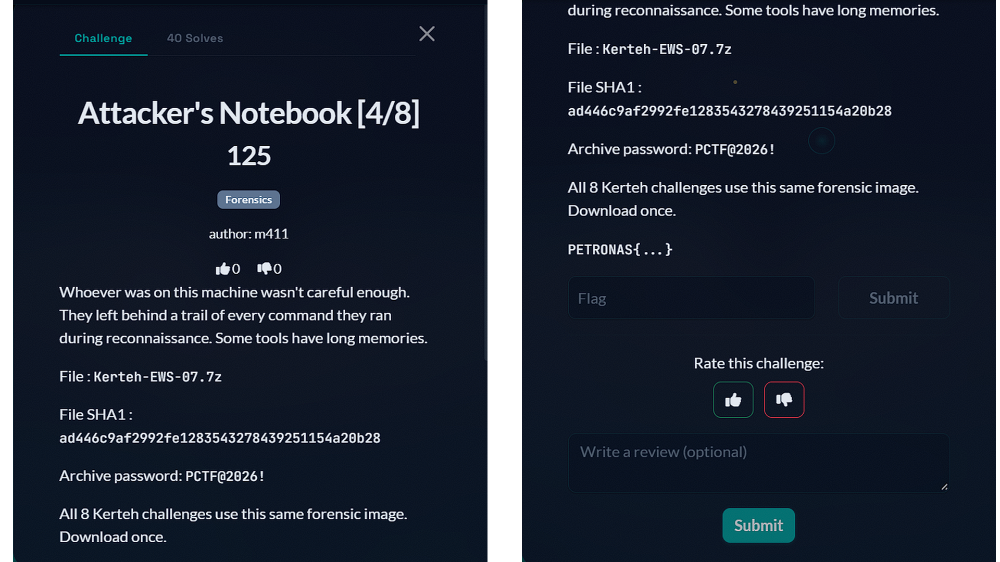

# Attacker's Notebook [4.8]

## Challenge

<p align="center">
  
</p>

## Solution

This writeup assumes you are new to CTFs and digital forensics. We will walk through how to find the command history left behind by an attacker, which is a crucial part of understanding what actions were taken during a breach.

### 1. Challenge Overview

The challenge description gives us a very strong hint:
> *"Whoever was on this machine wasn't careful enough. They left behind a trail of every command they ran during reconnaissance. Some tools have long memories."*

**Breakdown of the clues:**
*   **"Left behind a trail of every command"**: In Windows, command-line interfaces (like Command Prompt and PowerShell) keep a history of what the user typed.
*   **"Some tools have long memories"**: This is a classic hint pointing to **PowerShell**. By default, modern PowerShell saves the command history to a text file on the disk so the user can press the "Up" arrow to recall previous commands, even after closing the terminal.

Our goal is to find this history file and read the attacker's "notebook."

### 2. Step 1 — Finding the History File

First, make sure you are in the `extracted_vm` directory:
```bash
cd ~/Downloads/PETCTF2026PrelimWriteup/Kerteh/1\ -\ Infected\ Package/extracted_vm
```

PowerShell stores its history in a file named `ConsoleHost_history.txt` inside the user's AppData folder. Let's read it:

```bash
cat "Users/a.rahman/AppData/Roaming/Microsoft/Windows/PowerShell/PSReadLine/ConsoleHost_history.txt"
```

### 3. Step 2 — Analyzing the Attacker's Commands

The output will show every command the attacker typed. Let's look at a snippet of what you will see:

```text
cd C:\Users\a.rahman\Desktop
dir
whoami /all
systeminfo | findstr /B /C:"OS Name" /C:"OS Version" /C:"System Type"
ipconfig /all
arp -a
netstat -ano | findstr ESTABLISHED
...
net user
net localgroup Administrators
...
Test-NetConnection -ComputerName 10.4.17.50 -Port 502
...
```

This is a textbook **Reconnaissance** phase. The attacker is mapping out the network, checking their user privileges, looking for active connections, and scanning for industrial control systems (like the Triconex controller on port 502).

Right in the middle of these commands, the attacker left the flag:

```text
echo PETRONAS{R3C0N_H1ST0RY_TR4C3D}
```

You can also see further down that they begin staging data (`copy "C:\ProgramData\Triconex\scada_dump.bin"...`) and beaconing out to their C2 server, confirming the timeline of the attack.

### 4. The Flag

**`PETRONAS{R3C0N_H1ST0RY_TR4C3D}`**

### 5. Cheat Sheet — Commands Used

```bash
# 1. Navigate to the extracted VM
cd ~/Downloads/PETCTF2026PrelimWriteup/Kerteh/1\ -\ Infected\ Package/extracted_vm

# 2. Read the PowerShell command history
cat "Users/a.rahman/AppData/Roaming/Microsoft/Windows/PowerShell/PSReadLine/ConsoleHost_history.txt"
```

## Flag

```text
PETRONAS{R3C0N_H1ST0RY_TR4C3D}
```
