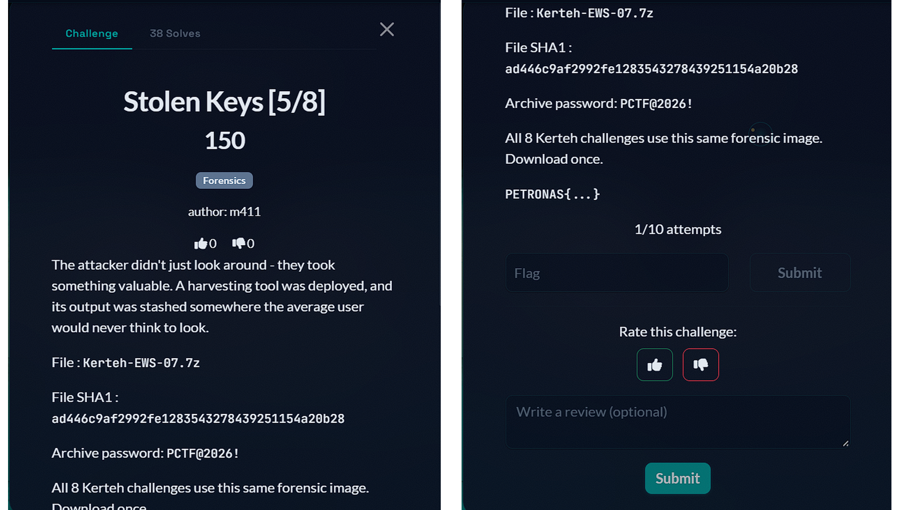

# Stolen Keys [5.8]

## Challenge

<p align="center">
  
</p>

## Solution

## Solution

This writeup assumes you are new to CTFs and digital forensics. We will walk through how to find hidden files in Windows user profiles and how to use command-line searching to track down stolen credentials.

### 1. Challenge Overview

The challenge description gives us a specific profile of the attacker's actions:
> *"The attacker didn't just look around - they took something valuable. A harvesting tool was deployed, and its output was stashed somewhere the average user would never think to look."*

**Breakdown of the clues:**
*   **"A harvesting tool"**: This refers to tools like Mimikatz, LaZagne, or custom scripts that are used to dump credentials, passwords, and Kerberos tickets from memory or local storage.
*   **"Stashed somewhere the average user would never think to look"**: The average user only browses their Documents, Desktop, and Downloads. Attackers hide their loot deep inside hidden system folders like `AppData`, `ProgramData`, or `Windows/Temp`.

### 2. Step 1 — Triage the Obvious Spots

We already know from previous challenges that the attacker was interacting with `C:\ProgramData\Triconex\`. Let's check there first:

```bash
cd ~/Downloads/PETCTF2026PrelimWriteup/Kerteh/1\ -\ Infected\ Package/extracted_vm
ls -la ProgramData/Triconex/
```

**Output:**
```text
-rw-rw-r-- 1 kali kali   45 Nov 11 04:56 id.cfg
-rw-rw-r-- 1 kali kali  256 Nov 11 04:56 scada_dump.bin
drwxrwxr-x 2 kali kali 4096 Nov 11 04:56 staged_data
-rw-rw-r-- 1 kali kali 4096 Nov 11 04:55 svchost.exe
```
There is a fake `svchost.exe` (a common malware disguise), but no obvious text files with credentials. 

### 3. Step 2 — Hunt for the Flag (The Pro Move)

Instead of manually opening every folder in `AppData` and `ProgramData`, we can use `grep` to search the entire filesystem for the flag format. 

We will search the `Users/`, `ProgramData/`, and `Windows/Temp/` directories, forcing `grep` to read binary files as text (`-a`) and suppressing permission errors (`2>/dev/null`):

```bash
grep -r -a "PETRONAS{" Users/ ProgramData/ Windows/Temp/ 2>/dev/null
```

**Output:**
```text
Users/a.rahman/AppData/Local/Temp/~svc_diag.ps1:$exfilKey = "PETRONAS{SCR1PTB10CK_4UD1T}"
Users/a.rahman/AppData/Local/Microsoft/Vault/vault_export.log:  Password : PETRONAS{CR3D_H4RV3ST3D}
Users/a.rahman/AppData/Roaming/Microsoft/Windows/PowerShell/PSReadLine/ConsoleHost_history.txt:echo PETRONAS{R3C0N_H1ST0RY_TR4C3D}
Users/a.rahman/Desktop/SCADA_Configs/gpp3_controller.yaml:exfil:Verification: PETRONAS{H1DD3N_D4T4_STR34M}
```

We hit the jackpot! We see multiple flags from different challenges. For this specific challenge, look at the second line:

`Users/a.rahman/AppData/Local/Microsoft/Vault/vault_export.log`

This is the output of the credential harvester. The attacker dumped the Windows Vault (where saved passwords are stored) and exported it to this log file, hoping no one would look in the `AppData/Local/Microsoft/Vault` directory.

### 4. The Flag

**`PETRONAS{CR3D_H4RV3ST3D}`**

### 5. Cheat Sheet — Commands Used

```bash
# 1. Navigate to the extracted VM
cd ~/Downloads/PETCTF2026PrelimWriteup/Kerteh/1\ -\ Infected\ Package/extracted_vm

# 2. Search the entire filesystem for the flag format
grep -r -a "PETRONAS{" Users/ ProgramData/ Windows/Temp/ 2>/dev/null
```

## Flag

```text
PETRONAS{CR3D_H4RV3ST3D}
```
