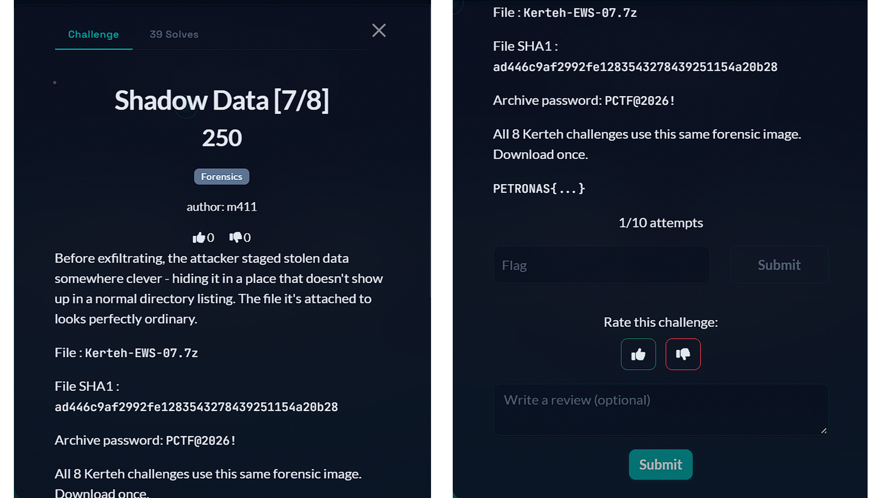

# Shadow Data [7.8]

## Challenge

<p align="center">
  
</p>

## Solution

This writeup assumes you are new to CTFs and digital forensics. We will walk through how attackers hide stolen data inside perfectly normal files using Windows Alternate Data Streams (ADS), and how to find them.

### 1. Challenge Overview

The challenge description gives us the exact methodology the attacker used:
> *"Before exfiltrating, the attacker staged stolen data somewhere clever - hiding it in a place that doesn't show up in a normal directory listing. The file it's attached to looks perfectly ordinary."*

**Breakdown of the clues:**
*   **"Doesn't show up in a normal directory listing"**: When a user runs the `dir` command in Windows, hidden files and alternate streams are invisible by default.
*   **"Attached to a perfectly ordinary file"**: This is the textbook definition of a Windows **Alternate Data Stream (ADS)**. NTFS allows multiple data streams to be attached to a single file. Attackers use this to hide malware or stolen data inside images, text files, or configuration files without changing the file's size or visible contents.

When `7z` extracts a Windows drive, it saves these hidden streams as separate files using the format `filename:streamname`.

### 2. Step 1 — Find the Alternate Data Streams

First, ensure you are in the extracted VM directory:
```bash
cd ~/Downloads/PETCTF2026PrelimWriteup/Kerteh/1\ -\ Infected\ Package/extracted_vm
```

We can use the `find` command to look for any files that contain a colon (`:`) in their name. On Linux, this indicates an extracted Alternate Data Stream.

```bash
find . -type f -name "*:*" 2>/dev/null
```

**Output:**
```text
... (NTFS system files ignored) ...
./Users/a.rahman/Desktop/SCADA_Configs/gpp3_controller.yaml:exfil
```

We found it! The attacker attached a hidden stream named `exfil` to a normal-looking SCADA configuration file (`gpp3_controller.yaml`).

### 3. Step 2 — Read the Hidden Data

Now that we know where the hidden stream is, we can simply `cat` the file to read the attacker's staged data:

```bash
cat "Users/a.rahman/Desktop/SCADA_Configs/gpp3_controller.yaml:exfil"
```

**Output:**
```text
EXFILTRATION STAGING - DO NOT TRANSMIT IN CLEAR
================================================
Campaign  : XENOTIME-KERTEH
Timestamp : 2026-10-29 03:14:22 UTC
Operator  : TsNIIKhM-7

Verification: PETRONAS{H1DD3N_D4T4_STR34M}
...
```

The flag literally translates to "Hidden Data Stream". 

### 4. The Flag

**`PETRONAS{H1DD3N_D4T4_STR34M}`**

### 5. Cheat Sheet — Commands Used

```bash
# 1. Navigate to the extracted VM
cd ~/Downloads/PETCTF2026PrelimWriteup/Kerteh/1\ -\ Infected\ Package/extracted_vm

# 2. Find Alternate Data Streams (files with a colon in the name)
find . -type f -name "*:*" 2>/dev/null

# 3. Read the hidden stream
cat "Users/a.rahman/Desktop/SCADA_Configs/gpp3_controller.yaml:exfil"
```

## Flag

```text
PETRONAS{H1DD3N_D4T4_STR34M}
```
