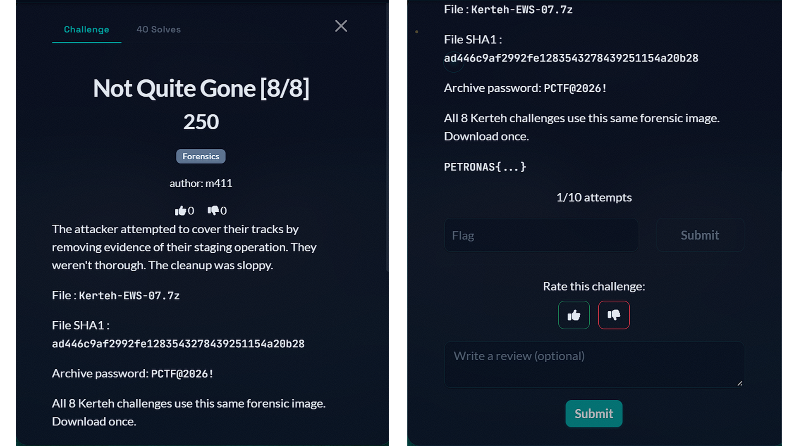

# Not Quite Gone [8.8]

## Challenge

<p align="center">
  
</p>

## Solution

This writeup assumes you are new to CTFs and digital forensics. We will walk through how Windows handles deleted files, how to find data in the Recycle Bin, and how to prove an attacker's "sloppy cleanup."

### 1. Challenge Overview

The challenge description gives us the core hint:
> *"The attacker attempted to cover their tracks by removing evidence of their staging operation. They weren't thorough. The cleanup was sloppy."*

**Breakdown of the clues:**
*   **"Removing evidence"**: The attacker deleted files (likely the `exfil_manifest.txt` and `staged_data` we saw earlier).
*   **"Sloppy cleanup"**: When a user or attacker deletes a file in Windows using the standard Delete key or command, it does not vanish permanently. It gets moved to the `$Recycle.Bin`. The attacker failed to securely wipe the disk or empty the bin.

### 2. Step 1 — Locating the Recycle Bin

First, ensure you are in the extracted VM directory:
```bash
cd ~/Downloads/PETCTF2026PrelimWriteup/Kerteh/1\ -\ Infected\ Package/extracted_vm
```

The `$Recycle.Bin` is a hidden system folder at the root of every Windows drive. Let's list its contents recursively to see if the attacker left anything behind:

```bash
ls -laR '$Recycle.Bin'
```

**Output:**
```text
'$Recycle.Bin/S-1-5-21-2618041978-2334743221-1777600817-1001':
-rw-rw-r-- 1 kali kali  118 Nov 11 04:56 '$I4WR5N5.txt'
-rw-rw-r-- 1 kali kali  969 Nov 11 04:56 '$R4WR5N5.txt'
```

The folder ending in `-1001` belongs to the user `a.rahman`. Inside, we see two files starting with `$I` and `$R`. 
*   **`$I` files** (e.g., `$I4WR5N5.txt`) contain metadata, including the original file path and deletion date.
*   **`$R` files** (e.g., `$R4WR5N5.txt`) contain the actual data of the deleted file.

### 3. Step 2 — Reading the Metadata

Let's read the `$I` file to see where the file originally lived before it was deleted:

```bash
cat '$Recycle.Bin/S-1-5-21-2618041978-2334743221-1777600817-1001/$I4WR5N5.txt'
```

**Output:**
```text
��}}�Uq�-C:\Users\a.rahman\Desktop\exfil_manifest.txt
```
*(The weird characters at the start are binary metadata, but the readable part at the end confirms the original file was `C:\Users\a.rahman\Desktop\exfil_manifest.txt`).*

### 4. Step 3 — Reading the Deleted Evidence

Now, let's read the actual content of the deleted file using the `$R` file:

```bash
cat '$Recycle.Bin/S-1-5-21-2618041978-2334743221-1777600817-1001/$R4WR5N5.txt'
```

**Output:**
```text
================================================================
  XENOTIME-KERTEH  EXFILTRATION MANIFEST
  Generated : 2026-10-30 01:45:33 UTC
  Operator  : XNT-7
  C2 Server : 185.141.27.93:8443
================================================================

Status: READY FOR EXFILTRATION

Collected Assets:
  1. gpp3_controller.yaml    Tricon MP3008 safety config
  2. tgast_plc_map.xml       PLC I/O mapping
  3. historian_20261028.csv   72h process data export
  4. ot_network_topo.png      OT network diagram (10.4.17.0/24)
  5. vault_export.log         5 harvested credentials

Manifest Key: PETRONAS{R3CYCL3_B1N_F0R3NS1CS}

Exfil Plan:
  - Base64-encode payload
  - POST to http://185.141.27.93:8443/exfil
  - Header X-Campaign: XENOTIME-KTH
  - Rotate C2 after confirmation
  - Wipe staging directory
  - Remove persistence (TriconexUpdater, TriconexHealthCheck)
================================================================
```

This is the "smoking gun" of the entire investigation. It summarizes the whole attack: the stolen files, the Command & Control server, the exfiltration plan, and the list of all the persistence mechanisms we found in the previous challenges. And right in the middle is the flag.

### 5. The Flag

**`PETRONAS{R3CYCL3_B1N_F0R3NS1CS}`**

### 6. Cheat Sheet — Commands Used

```bash
# 1. Navigate to the extracted VM
cd ~/Downloads/PETCTF2026PrelimWriteup/Kerteh/1\ -\ Infected\ Package/extracted_vm

# 2. List the Recycle Bin contents
ls -laR '$Recycle.Bin'

# 3. Read the metadata (to find the original file path)
cat '$Recycle.Bin/S-1-5-21-2618041978-2334743221-1777600817-1001/$I4WR5N5.txt'

# 4. Read the deleted data file (the actual manifest)
cat '$Recycle.Bin/S-1-5-21-2618041978-2334743221-1777600817-1001/$R4WR5N5.txt'
```

## Flag

```text
PETRONAS{R3CYCL3_B1N_F0R3NS1CS}
```

