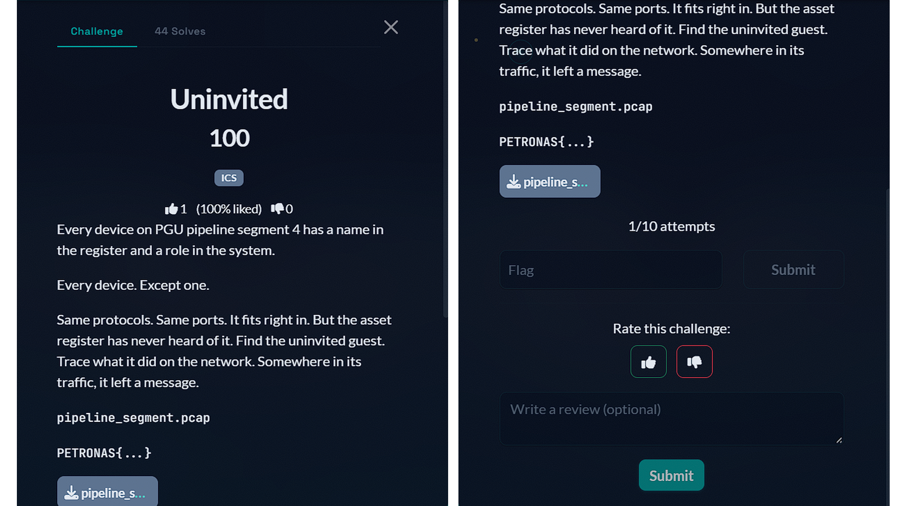

# 1 - Uninvited

## Challenge

<p align="center">
  
</p>

## Solution

This writeup assumes you are new to CTFs and network forensics. We will walk through how to analyze a packet capture (`.pcap`) file, identify rogue devices on an ICS (Industrial Control System) network, and extract hidden messages from unencrypted traffic.

### 1. Challenge Overview

The challenge description gives us the profile of the attacker:
> *"Every device on PGU pipeline segment 4 has a name in the register and a role in the system. Every device. Except one. Same protocols. Same ports. It fits right in. But the asset register has never heard of it. Find the uninvited guest. Trace what it did on the network. Somewhere in its traffic, it left a message."*

**Breakdown of the clues:**
*   **"Same protocols. Same ports"**: The attacker is using legitimate industrial protocols (like Modbus) to blend in.
*   **"Left a message"**: The attacker sent a payload over the network that contains the flag.

### 2. Step 1 — The Quick CTF Method (Strings)

The fastest way to find plaintext in a packet capture is to use `strings`. Because ICS protocols are often unencrypted, we can find the flag directly in the raw bytes of the file.

Navigate to the challenge folder:
```bash
cd ~/Downloads/PETCTF2026PrelimWriteup/Segamat/1\ -\ Uninvited
```

Run `strings` and filter for the flag format:
```bash
strings pipeline_segment.pcap | grep -i "PETRONAS"
```

**Output:**
```text
&PETRONAS{sl0w_p01s0n_b34ts_th3_4l4rms}
```

We found it instantly! The `&` at the beginning is a delimiter used in the ICS protocol structure.

### 3. Step 2 — The Proper Forensic Method (Wireshark/tshark)

While `strings` works for CTFs, a real network analyst would use a packet analyzer to find *which* device sent the message and analyze the protocol structure.

**Identify Endpoints:**
First, we use `tshark` to list all the IP addresses communicating on the network:
```bash
tshark -r pipeline_segment.pcap -q -z endpoints,ip
```

**Output:**
```text
10.4.88.20    4147 packets (SCADA Server)
10.4.88.10    1532 packets (Engineering Workstation)
...
10.4.88.45    66 packets   (Suspicious IP)
```

The IP `10.4.88.45` stands out because it has a very low packet count and is not a known asset in the standard network register.

**Trace the Message:**
To find which packet contains the flag, we filter by the string and print the source and destination IPs:
```bash
tshark -r pipeline_segment.pcap -Y 'frame contains "PETRONAS"' -T fields -e ip.src -e ip.dst
```

**Output:**
```text
10.4.88.45      10.4.88.20
```
This proves the uninvited guest (`10.4.88.45`) sent the payload directly to the SCADA Server (`10.4.88.20`).

**Dump the Packet Payload (Hex/ASCII):**
To read the actual message, we ask `tshark` to isolate the traffic from the rogue IP and output a raw Hex + ASCII dump using the `-x` flag:

```bash
tshark -r pipeline_segment.pcap -Y 'ip.src == 10.4.88.45' -x
```

**Output:**
```text
...
0030  20 00 9f 16 00 00 05 ff 00 00 00 2d 01 10 01 00    ..........-....
0040  00 13 26 50 45 54 52 4f 4e 41 53 7b 73 6c 30 77   ..&PETRONAS{sl0w
0050  5f 70 30 31 73 30 6e 5f 62 33 34 74 73 5f 74 68   _p01s0n_b34ts_th
0060  33 5f 34 6c 34 72 6d 73 7d                         3_4l4rms}
```

Look at the right-hand column (the ASCII representation). You can clearly see `&PETRONAS{sl0w_p01s0n_b34ts_th3_4l4rms}` embedded in the Modbus TCP payload (indicated by the `26` hex byte just before `PETRONAS`).

### 4. Why "Slow Poison"?

The flag `sl0w_p01s0n_b34ts_th3_4l4rms` references a specific ICS attack tactic. Instead of suddenly shutting down a valve or blowing up a tank (which would trigger immediate alarms), the attacker sends tiny, incremental changes to the PLC over time. The system's alarms never trigger because the changes are below the threshold, but eventually, the physical process is poisoned into a dangerous state.

### 5. The Flag

**`PETRONAS{sl0w_p01s0n_b34ts_th3_4l4rms}`**

### 6. Cheat Sheet — Commands Used

```bash
# 1. Quick method: Extract strings and search for the flag
strings pipeline_segment.pcap | grep -i "PETRONAS"

# 2. Pro method: Analyze endpoints (IPs) in the pcap
tshark -r pipeline_segment.pcap -q -z endpoints,ip

# 3. Pro method: Find which IP sent the flag and where it went
tshark -r pipeline_segment.pcap -Y 'frame contains "PETRONAS"' -T fields -e ip.src -e ip.dst

# 4. Pro method: Dump the Hex/ASCII of the rogue traffic to read the message
tshark -r pipeline_segment.pcap -Y 'ip.src == 10.4.88.45' -x
```

## Flag

```text
PETRONAS{sl0w_p01s0n_b34ts_th3_4l4rms}
```
