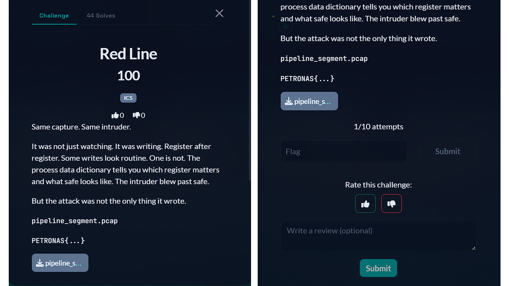

# 2 - Red Line

## Challenge

<p align="center">
  
</p>

## Solution

This writeup assumes you are new to CTFs and network forensics. We will walk through how to isolate an attacker's traffic in a packet capture and extract hidden messages from HTTP requests.

### 1. Challenge Overview

The challenge description tells us that the attacker has moved from just watching the network to actively manipulating it:
> *"It was not just watching. It was writing. Register after register. Some writes look routine. One is not. The process data dictionary tells you which register matters and what safe looks like. The intruder blew past safe. But the attack was not the only thing it wrote."*

**Breakdown of the clues:**
*   **"Writing... Register after register"**: The attacker is sending Modbus Write commands (Function Codes 6 or 16) to change values on the PLC.
*   **"Blew past safe"**: They wrote a value that is outside the safe operational limits (the "Red Line").
*   **"Not the only thing it wrote"**: The attacker also sent a separate message over the network (likely an HTTP report) that contains the flag.

From the previous challenge, we already know the attacker's IP address is `10.4.88.45` and the SCADA server's IP is `10.4.88.20`.

### 2. Step 1 — Finding the Hidden Message

If you look at the traffic from the attacker, you will see a mix of Modbus TCP commands and HTTP requests. While the Modbus commands are changing the physical process, the HTTP requests are how the attacker reports back to their own staging server (or logs into the SCADA server).

We can use `tshark` to filter for HTTP POST requests sent by the attacker and extract the form data (`urlencoded-form.value`):

```bash
cd ~/Downloads/PETCTF2026PrelimWriteup/Segamat/2\ -\ Red\ Line
tshark -r pipeline_segment.pcap -Y 'ip.src == 10.4.88.45 && http.request' -T fields -e urlencoded-form.value
```

**Output:**
```text
[recon_complete] target=10.4.88.20 model=S7-400 seg=4 flag=W3JlY29uX2NvbXBzZXRlXSB0YXJnZXQ9MTAuNC44OC4yMCBtb2RlbD1TNy00MDAgc2VnPTQgZmxhZz1QRVRST05BU3tuMF8wZHRoX24wX3MzZ20zbnRfZzRtM18wdjNyeQ==
```
*(Note: If your output shows the raw Base64 string without `flag=` in front, you can just copy the string starting with `W3JlY29u...`)*

### 3. Step 2 — Decoding the Payload

The attacker has Base64-encoded their report. We can decode it right in the terminal:

```bash
echo "W3JlY29uX2NvbXBzZXRlXSB0YXJnZXQ9MTAuNC44OC4yMCBtb2RlbD1TNy00MDAgc2VnPTQgZmxhZz1QRVRST05BU3tuMF8wZHRoX24wX3MzZ20zbnRfZzRtM18wdjNyeQ==" | base64 -d
```

**Decoded Output:**
```text
[recon_complete] target=10.4.88.20 model=S7-400 seg=4 flag=PETRONAS{n0_0uth_n0_s3gmznt_g4m3_0v3ry}
```

### 4. The Flag

**`PETRONAS{n0_0uth_n0_s3gmznt_g4m3_0v3ry}`**

### 5. Cheat Sheet — Commands Used

```bash
# 1. Filter for HTTP POST requests from the attacker
tshark -r pipeline_segment.pcap -Y 'ip.src == 10.4.88.45 && http.request' -T fields -e urlencoded-form.value

# 2. Decode the Base64 payload to reveal the flag
echo "BASE64_STRING_HERE" | base64 -d
```

## Flag

```text
PETRONAS{n0_0uth_n0_s3gmznt_g4m3_0v3ry}
```
